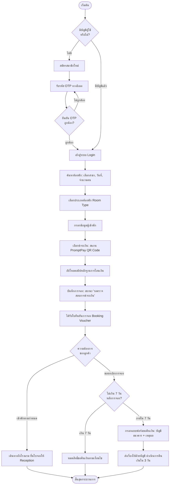
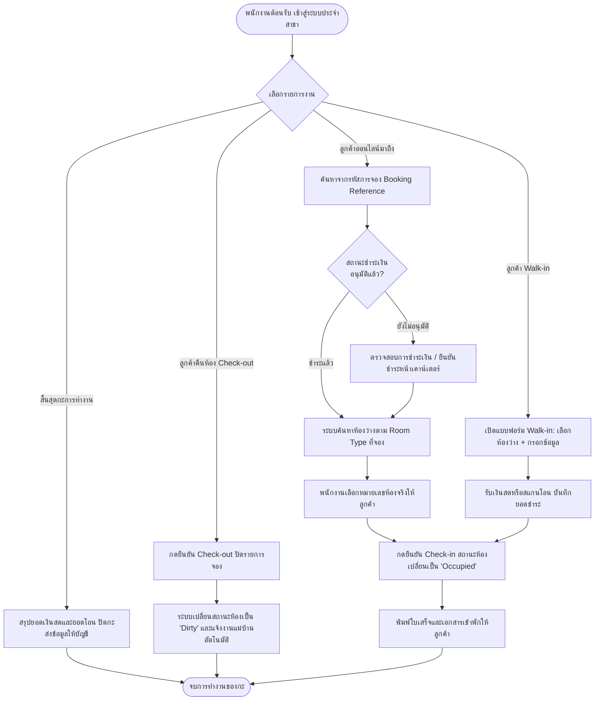
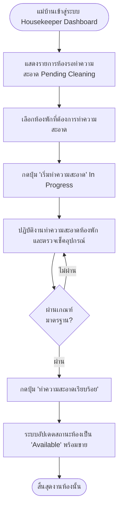
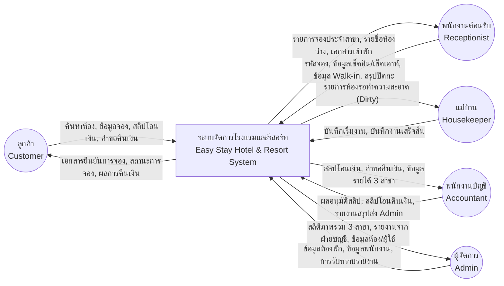
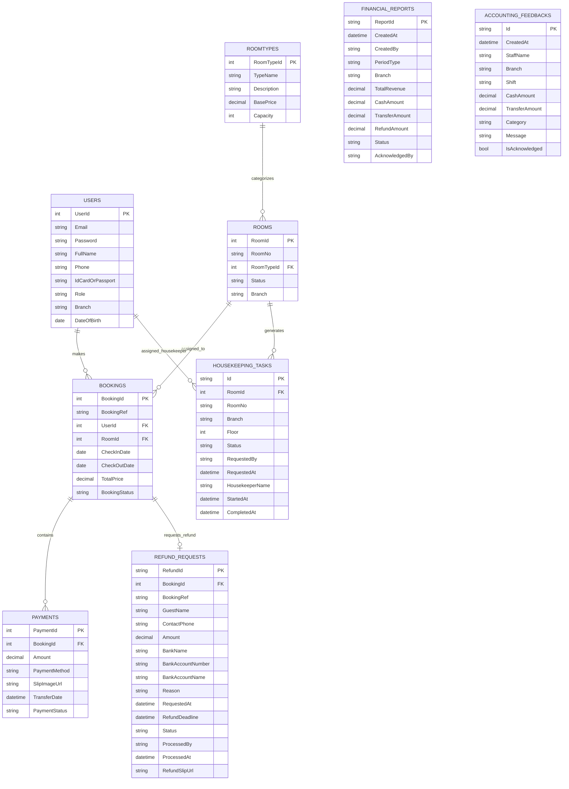

# เอกสารนำเสนอโปรเจกต์
# เรื่อง ระบบจัดการโรงแรมและรีสอร์ทออนไลน์ข้ามสาขา (Easy Stay Hotel & Resort)

---

### จัดทำโดย
* **[รหัสนักศึกษา]** [ชื่อ-นามสกุล นักศึกษา]
* สาขาวิชาวิศวกรรมซอฟต์แวร์ / เทคโนโลยีสารสนเทศและนวัตกรรมดิจิทัล

### เสนอ
* **อาจารย์ ณัฐพล พุทธจรรยาวงศ์** (หรืออาจารย์ประจำวิชา)

---

**รายงานฉบับนี้เป็นส่วนหนึ่งของการศึกษา**  
**วิชา CSI402 การเชื่อมต่อโปรแกรมส่วนหน้ากับโปรแกรมส่วนหลัง (Frontend & Backend Integration)**  
**ภาคเรียนที่ 2 ปีการศึกษา 2568**  
**มหาวิทยาลัยศรีปทุม กรุงเทพมหานคร**  

---

<div style="page-break-after: always;"></div>

## สารบัญ (Table of Contents)

1. [ความต้องการของผู้ใช้ (Requirement)](#1-ความต้องการของผู้ใช้-requirement)
2. [บทบาทผู้ใช้และสิทธิ์การใช้งาน (User Roles & Permissions)](#2-บทบาทผู้ใช้และสิทธิ์การใช้งาน-user-roles--permissions)
3. [ขอบเขตของระบบ (System Scope)](#3-ขอบเขตของระบบ-system-scope)
4. [ผังงานกระบวนการทำงาน (Flowchart)](#4-ผังงานกระบวนการทำงาน-flowchart)
   - 4.1 ผังงานกระบวนการฝั่ง Customer (ลูกค้า)
   - 4.2 ผังงานกระบวนการฝั่ง Receptionist (พนักงานต้อนรับ)
   - 4.3 ผังงานกระบวนการฝั่ง Housekeeper (พนักงานแม่บ้าน)
   - 4.4 ผังงานกระบวนการฝั่ง Accounting (ฝ่ายบัญชีและการเงิน)
   - 4.5 ผังงานกระบวนการฝั่ง Admin (ผู้บริหาร / ผู้ดูแลระบบ)
   - 4.6 Flowchart แต่ละฟังก์ชันสำคัญของระบบ
5. [แผนภาพการไหลของข้อมูล (Data Flow Diagram - DFD)](#5-แผนภาพการไหลของข้อมูล-data-flow-diagram---dfd)
   - 5.1 DFD Context Diagram (ภาพรวมระบบ)
   - 5.2 DFD Level 1 (กระบวนการหลัก 8 กระบวนการ)
   - 5.3 รายละเอียดกระบวนการสำคัญ (DFD Process Descriptions)
6. [การออกแบบฐานข้อมูล (Data Dictionary & ER Diagram)](#6-การออกแบบฐานข้อมูล-data-dictionary--er-diagram)
   - 6.1 แผนภาพความสัมพันธ์ของข้อมูล (ER Diagram)
   - 6.2 พจนานุกรมข้อมูล (Data Dictionary 9 ตาราง)
7. [รายละเอียดและโค้ดของแต่ละหน้าของระบบ (Screen Specifications & Implementation)](#7-รายละเอียดและโค้ดของแต่ละหน้าของระบบ)
   - หน้าที่ 1: หน้า Login (เข้าสู่ระบบตามบทบาท)
   - หน้าที่ 2: หน้า Register & OTP (สมัครสมาชิกและยืนยันตัวตน)
   - หน้าที่ 3: หน้า Home (หน้าหลัก ค้นหาห้องพัก 3 สาขา)
   - หน้าที่ 4: หน้า Search & Room Catalog (แสดงประเภทห้องพักและราคา)
   - หน้าที่ 5: หน้า Checkout & Payment (กรอกข้อมูลผู้เข้าพัก ชำระเงิน PromptPay และอัปโหลดสลิป)
   - หน้าที่ 6: หน้า BookingSuccess & Voucher (ใบยืนยันการจองและเอกสารหลักฐานการเข้าพัก)
   - หน้าที่ 7: หน้า MyBookings & Refund (ประวัติการจองและโมดอลยื่นคำร้องขอคืนเงิน)
   - หน้าที่ 8: หน้า Profile (แก้ไขข้อมูลส่วนตัวและเบอร์โทรศัพท์ลูกค้า)
   - หน้าที่ 9: หน้า Staff BookingList (หน้ารายการจอง ค้นหารหัสจอง และกรองสถานะ)
   - หน้าที่ 10: หน้า Staff Check-in Desk (จัดสรรเลขห้องจริงให้ลูกค้าเช็คอิน)
   - หน้าที่ 11: หน้า Staff Walk-in Booking (เปิดจองและเช็คอินทันทีหน้าเคาน์เตอร์)
   - หน้าที่ 12: หน้า Staff Room Management (พนักงานจัดการห้องพักประจำสาขา)
   - หน้าที่ 13: หน้า Housekeeper Dashboard (กระดานงานทำความสะอาดห้องพักของแม่บ้าน)
   - หน้าที่ 14: หน้า Accounting Payment Verification (ตรวจสอบสลิปการโอนเงินของลูกค้า)
   - หน้าที่ 15: หน้า Accounting Refund Processing (พิจารณาและโอนเงินคืนลูกค้าภายใน 3 วัน)
   - หน้าที่ 16: หน้า Accounting Financial Dashboard (รายงานรายได้ กราฟวิเคราะห์ และส่งผู้จัดการ)
   - หน้าที่ 17: หน้า Admin Dashboard (ภาพรวมผู้บริหาร ยอดจอง รายได้ และรับรายงานจากบัญชี)
   - หน้าที่ 18: หน้า Admin User Management (จัดการผู้ใช้งานและพนักงานแยกแท็บตาม Role)
8. [สรุปผลการดำเนินงานและข้อเสนอแนะ (Conclusion & Future Work)](#8-สรุปผลการดำเนินงานและข้อเสนอแนะ)

---

<div style="page-break-after: always;"></div>

## 1. ความต้องการของผู้ใช้ (Requirement)

**Easy Stay Hotel & Resort** เป็นระบบบริหารจัดการโรงแรมและรีสอร์ทออนไลน์แบบบูรณาการครบวงจร (Full-Stack Hotel Property Management & Cross-Branch Direct Booking System) พัฒนาขึ้นเพื่อแก้ปัญหาและยกระดับการให้บริการของเครือโรงแรมขนาดกลางถึงขนาดใหญ่ที่ดำเนินงานครอบคลุม **3 สาขาในจังหวัดท่องเที่ยวหลักของประเทศไทย**:
1. **สาขากรุงเทพมหานคร (Bangkok Branch)** - โรงแรมหรูใจกลางย่านธุรกิจและการเดินทาง
2. **สาขาชลบุรี - พัทยา (Chonburi Branch)** - โรงแรมและรีสอร์ทริมชายหาดพัทยา
3. **สาขาภูเก็ต (Phuket Branch)** - รีสอร์ทหรูริมทะเลอันดามัน

### ปัญหาของระบบเดิม (Problem Statement)
* การจองห้องพักในอดีตลูกค้ามักเจอปัญหาการล็อกห้องระบุเลขห้องตั้งแต่ตอนจอง ทำให้โรงแรมขาดความยืดหยุ่นในการบริหารสต็อกห้องพักจริง (Room Inventory Allocation)
* ฝ่ายต้อนรับ (Front Desk), ฝ่ายแม่บ้าน (Housekeeping), และฝ่ายการเงิน (Accounting) ทำงานแบบแยกส่วน (Data Silos) ขาดการเชื่อมโยงข้อมูลแบบอัตโนมัติ ส่งผลให้การเช็คอินล่าช้าและห้องพักทำความสะอาดไม่ทันรองรับแขกใหม่
* การขอคืนเงิน (Refund) ของลูกค้ามีความยุ่งยาก เอกสารตกหล่น และไม่มีกำหนดเวลาที่ชัดเจน
* ผู้จัดการและผู้บริหารขาดเครื่องมือในการดูภาพรวมผลประกอบการทางการเงินเปรียบเทียบข้ามสาขาแบบ Real-time

### ความต้องการของระบบใหม่ (Functional Requirements)
* **สำหรับลูกค้า (Customer)**: สามารถค้นหาและจองห้องพักข้ามสาขาได้ตาม "ประเภทห้องพัก (Room Type)" โดยไม่ต้องเห็นเลขห้องตอนจอง, ชำระเงินผ่านระบบ PromptPay QR Code พร้อมแนบหลักฐานสลิปโอนเงิน, ได้รับเอกสารยืนยันการจอง (Booking Confirmation Voucher) พร้อม QR Code ทันที และสามารถยื่นเรื่องขอคืนเงิน (Refund) ได้ด้วยตนเองภายใน 7 วันหลังจากการจองผ่านระบบ
* **สำหรับพนักงานต้อนรับ (Receptionist / Front Desk Staff)**: มีหน้าต่างจัดการการจอง (Staff Booking Console) ตรวจสอบประวัติการจอง ค้นหาด้วยรหัสจอง (Booking Reference) หรือชื่อลูกค้า, ทำการเช็คอินโดยเลือกห้องจริงที่ว่างตาม Room Type ที่ลูกค้าจอง, จัดการลูกค้าที่ Walk-in เข้ามาเปิดห้องพักหน้าเคาน์เตอร์, พิมพ์ใบเสร็จรับเงิน/ใบเข้าพัก, และเมื่อลูกค้าเช็คเอาท์ ระบบจะส่งมอบห้องให้ฝ่ายแม่บ้านทำความสะอาดโดยอัตโนมัติ พร้อมทั้งมีระบบส่งยอดเงินปิดกะ (Cash/Transfer Handover) ไปยังฝ่ายบัญชี
* **สำหรับพนักงานแม่บ้าน (Housekeeper)**: มีแดชบอร์ดเฉพาะสำหรับติดตามสถานะห้องพักที่ต้องทำความสะอาด (Dirty / Pending Cleaning) แยกตามสาขาและชั้น สามารถกดรับงาน (Start Cleaning) และกดยืนยันทำความสะอาดเสร็จสิ้น (Complete Cleaning) เพื่อปลดล็อกห้องกลับมาเป็นสถานะ "พร้อมใช้งาน (Available)" โดยอัตโนมัติ
* **สำหรับพนักงานฝ่ายบัญชี (Accountant / Finance Staff)**: ตรวจสอบหลักฐานสลิปการโอนเงินของลูกค้าและอนุมัติการชำระเงิน, ตรวจสอบและพิจารณาคำร้องขอคืนเงิน (Refund Request) โดยมีเงื่อนไขต้องดำเนินการคืนเงินเข้าบัญชีธนาคารของลูกค้าภายใน 3 วันทำการ พร้อมแนบสลิปการโอนคืน, ดูสรุปภาพรวมรายได้ทั้งแบบรายวัน รายสัปดาห์ และรายเดือน พร้อมกราฟเปรียบเทียบ 3 สาขา และสามารถกดส่งข้อมูลสรุปทางการเงินไปยังผู้จัดการ (Admin) ได้ทันที
* **สำหรับผู้ดูแลระบบและผู้จัดการ (Admin / General Manager)**: มีแดชบอร์ดสรุปภาพรวมธุรกิจ อัตราการเข้าพัก (Occupancy Rate) สถิติยอดขาย 3 สาขา, การรับทราบรายงานการเงินจากฝ่ายบัญชี, การจัดการห้องพัก (เพิ่ม/ลบ/แก้ไข/กำหนดราคา), และการบริหารจัดการบัญชีผู้ใช้งาน โดยแยกหน้าระหว่าง "ลูกค้าทั่วไป (Customer)" และ "พนักงาน (Staff, Housekeeper, Accounting, Admin)" ออกจากกันอย่างเป็นสัดส่วน

---

<div style="page-break-after: always;"></div>

## 2. บทบาทผู้ใช้และสิทธิ์การใช้งาน (User Roles & Permissions)

ระบบจำแนกผู้ใช้งานออกเป็น 5 บทบาทหลัก (5 User Roles) โดยมีสิทธิ์การเข้าถึงข้อมูลและเมนูการใช้งานที่ปลอดภัยผ่านระบบ Session และ Authorization Guard ดังนี้:

| บทบาท (Role) | สิทธิ์การเข้าถึงและหน้าที่ความรับผิดชอบ | ขอบเขตข้อมูลที่มองเห็น |
| :--- | :--- | :--- |
| **1. Customer**<br>(ลูกค้าทั่วไป / สมาชิก) | - สมัครสมาชิก ยืนยัน OTP และเข้าสู่ระบบ<br>- ค้นหาห้องพัก 3 สาขา และจองตามประเภทห้อง<br>- ชำระเงิน โอนเงินผ่าน PromptPay แนบสลิป<br>- รับใบเสร็จ/ใบยืนยันการจอง (Voucher) พิมพ์หรือดาวน์โหลด<br>- ตรวจสอบสถานะการจอง และยื่นขอคืนเงินภายใน 7 วัน<br>- จัดการข้อมูลส่วนตัวและเบอร์โทรศัพท์ | ข้อมูลเฉพาะของตนเองเท่านั้น ไม่สามารถเข้าถึงหน้าหลังบ้านได้ |
| **2. Staff / Receptionist**<br>(พนักงานต้อนรับ) | - ดูรายการจอง ค้นหาด้วยรหัสจอง หรือชื่อลูกค้า<br>- ดำเนินการ Check-in โดยจัดสรรเลขห้องจริงที่ว่างให้ตรงประเภทห้อง<br>- ดำเนินการ Check-out และส่งมอบห้องให้แม่บ้านทำความสะอาด<br>- เปิดรับจองลูกค้า Walk-in หน้าเคาน์เตอร์ และเช็คอินทันที<br>- พิมพ์/ดาวน์โหลดเอกสารการจองและหลักฐานเข้าพัก<br>- ส่งยอดเงินสดและเงินโอนปิดกะให้ฝ่ายบัญชี | เฉพาะข้อมูลของสาขาที่ตนเองสังกัด (Bangkok, Chonburi หรือ Phuket) |
| **3. Housekeeper**<br>(พนักงานแม่บ้าน) | - เข้าใช้งาน Housekeeper Dashboard ประจำสาขา<br>- ดูรายการห้องที่รอทำความสะอาด (Pending Cleaning / Dirty)<br>- กดรับงานเริ่มทำความสะอาด (In Progress)<br>- ตรวจสอบ Checklist ความเรียบร้อย และกดยืนยันทำความสะอาดเสร็จ<br>- ปลดล็อกสถานะห้องเป็น Available (พร้อมขาย) ทันที | เฉพาะรายการห้องพักในสาขาที่ตนเองปฏิบัติหน้าที่ |
| **4. Accounting / Finance**<br>(พนักงานฝ่ายบัญชี) | - ตรวจสอบความถูกต้องของสลิปโอนเงิน และอนุมัติการชำระเงิน<br>- ตรวจสอบคำร้องขอคืนเงิน (Refund) และโอนเงินคืนภายใน 3 วันทำการ<br>- ตรวจสอบยอดเงินสดปิดกะที่พนักงานต้อนรับส่งเข้ามา<br>- ดูภาพรวมทางการเงิน รายวัน รายสัปดาห์ รายเดือน และกราฟวิเคราะห์<br>- ส่งรายงานสรุปผลประกอบการทางการเงินทั้ง 3 สาขาไปยัง Admin | ภาพรวมการเงินและการชำระเงินของทั้ง 3 สาขา |
| **5. Admin / Manager**<br>(ผู้จัดการ / ผู้ดูแลระบบ) | - ดูแดชบอร์ดภาพรวมผู้บริหาร อัตราการเข้าพัก ยอดขาย 3 สาขา<br>- รับทราบและตรวจทานรายงานสรุปทางการเงินที่ฝ่ายบัญชีส่งมา<br>- จัดการห้องพัก เพิ่ม แก้ไข ปรับราคา และกำหนดสาขา<br>- จัดการผู้ใช้งาน โดยแยกรายการลูกค้า และพนักงานทุก Role<br>- กำหนดสิทธิ์และสาขาของพนักงาน | มีสิทธิ์สูงสุด เข้าถึงและบริหารจัดการได้ทุกโมดูลในระบบ |

---

<div style="page-break-after: always;"></div>

## 3. ขอบเขตของระบบ (System Scope)

ระบบ Easy Stay Hotel & Resort รองรับการทำงานในขอบเขตหลัก 10 ด้าน ดังนี้:

### 3.1 ระบบสมัครสมาชิกและยืนยันตัวตน (Authentication & OTP Verification)
* สมัครสมาชิกใหม่พร้อมตรวจสอบรูปแบบอีเมล รหัสผ่าน และเบอร์โทรศัพท์
* ส่งรหัส OTP (One-Time Password) ไปยังอีเมลจริงเพื่อยืนยันตัวตนก่อนเปิดใช้งานบัญชี
* รองรับระบบรีเซ็ตรหัสผ่าน (Forgot Password) ผ่านอีเมล
* ระบบล็อกอินตรวจสอบสิทธิ์ (Role-based Routing) ส่งผู้ใช้ไปยังหน้าจอการทำงานตามบทบาทโดยอัตโนมัติ

### 3.2 ระบบค้นหาและจองห้องพักออนไลน์ (Direct Booking by Room Type)
* เลือกระบุสาขาที่ต้องการพัก (กรุงเทพมหานคร, ชลบุรี, ภูเก็ต)
* ระบุวันที่เช็คอิน วันที่เช็คเอาท์ และจำนวนผู้เข้าพัก
* แสดงผลห้องพักตามประเภทห้อง (Room Type: Standard, Deluxe, Suite, Family ฯลฯ) พร้อมราคาเริ่มต้น รายละเอียดสิ่งอำนวยความสะดวก และจำนวนห้องว่างจริง
* ลูกค้าไม่เห็นเลขห้องเฉพาะเจาะจงตอนจอง เพื่อให้โรงแรมจัดสรรห้องที่เหมาะสมที่สุดในวันเช็คอิน

### 3.3 ระบบการชำระเงินและการตรวจสอบสลิป (Payment & Slip Verification)
* สร้าง QR Code PromptPay ตามยอดชำระเงินจริงโดยอัตโนมัติ
* ลูกค้าสามารถอัปโหลดไฟล์ภาพสลิปหลักฐานการโอนเงินเข้าสู่ระบบ
* ข้อมูลการชำระเงินถูกส่งไปยังคิวตรวจสอบของฝ่ายบัญชีแบบทันที

### 3.4 ระบบออกเอกสารการจองและหลักฐานเข้าพัก (Booking Voucher & Receipt)
* ออกเอกสารยืนยันการจอง (Booking Confirmation Voucher) ที่มีหมายเลขการจอง (Booking Reference: เช่น `ES-25691117105142`)
* แสดง QR Code สำหรับสแกนตรวจสอบข้อมูล, รายละเอียดผู้จอง, ประเภทห้องพัก, วันที่เข้าพัก, และยอดเงิน
* มีปุ่มพิมพ์ (Print) และบันทึกเป็น PDF ทั้งในฝั่งลูกค้าและฝั่งพนักงานต้อนรับ

### 3.5 ระบบตรวจสอบสถานะและยื่นขอคืนเงิน (Refund Policy & Management)
* ลูกค้าสามารถตรวจสอบสถานะการจองได้จากเมนู "การจองของฉัน (My Bookings)"
* สามารถกดปุ่ม **"ขอคืนเงิน"** ได้ภายใน **7 วัน** นับจากวันที่ทำรายการจอง
* แบบฟอร์มขอคืนเงินรองรับการเลือกธนาคาร, เลขบัญชี/พร้อมเพย์, ชื่อบัญชี, เบอร์โทรศัพท์ และเหตุผลการขอคืนเงิน (มีช่องกรอกรายละเอียดเมื่อเลือก "อื่นๆ")
* คำขอคืนเงินจะถูกส่งตรงไปยังฝ่ายบัญชี โดยฝ่ายบัญชีมีพันธะสัญญาดำเนินการโอนเงินคืนเข้าบัญชีภายใน **3 วันทำการ** พร้อมแนบหลักฐานสลิปโอนคืน

### 3.6 ระบบเคาน์เตอร์พนักงานต้อนรับ (Front Desk & Room Allocation)
* ค้นหารายการจองของลูกค้าด้วย Booking Reference, ชื่อผู้จอง หรือเบอร์โทร
* ดำเนินการเช็คอิน โดยระบบจะดึงเฉพาะห้องพักที่สถานะ "ว่าง (Available)" และตรงกับ Room Type ที่ลูกค้าจองมาให้พนักงานเลือกจัดสรร
* ดำเนินการเช็คเอาท์ และส่งต่อสถานะห้องพักเข้าสู่คิวทำความสะอาดของแม่บ้านโดยอัตโนมัติ
* ระบบเปิดรับจองแบบ Walk-in สำหรับลูกค้าที่เดินทางมาเปิดห้องพักหน้าเคาน์เตอร์โดยตรง

### 3.7 ระบบจัดการงานแม่บ้าน (Housekeeping Task Workflow)
* กระดานงานแม่บ้านแบบ Real-time แสดงห้องพักที่รอทำความสะอาด (Pending/Dirty)
* แม่บ้านกดเริ่มทำความสะอาด (In Progress) เพื่อให้ระบบทราบว่ามีผู้รับผิดชอบ
* ระบบบันทึกเวลาที่เริ่มทำความสะอาดและเวลาที่เสร็จสิ้น
* เมื่อกดทำความสะอาดเสร็จสิ้น ระบบจะเปลี่ยนสถานะห้องเป็น "พร้อมใช้งาน (Available)" คืนเข้าสู่ระบบขายห้องพักทันที

### 3.8 ระบบฝ่ายบัญชีและการเงิน (Accounting & Multi-Branch Financial Overview)
* ตรวจสอบสลิปโอนเงิน อนุมัติการชำระเงิน หรือแจ้งปฏิเสธพร้อมระบุเหตุผล
* ดำเนินการคืนเงิน (Refund Approval) บันทึกหลักฐานสลิปโอนเงินคืน
* แดชบอร์ดสรุปรายได้แบบเลือกช่วงเวลา: รายวัน (Daily), รายสัปดาห์ (Weekly), และรายเดือน (Monthly)
* แสดงกราฟแท่งเปรียบเทียบแนวโน้มรายได้และกราฟโดนัทสัดส่วนรายได้แยกตาม 3 สาขา
* ฟังก์ชัน "ส่งข้อมูลให้ผู้จัดการ (Admin)" เพื่อสรุปยอดรายได้ส่งถึงหน้าจอผู้บริหารทันที

### 3.9 ระบบจัดการห้องพัก (Room & Branch Inventory Management)
* ผู้ดูแลระบบสามารถเพิ่มห้องพักใหม่ ระบุหมายเลขห้อง ประเภทห้อง ชั้น และสาขา
* แก้ไขข้อมูลห้องพัก ปรับเปลี่ยนราคา และปรับเปลี่ยนสถานะการซ่อมบำรุง (Maintenance)
* มีระบบตัวกรองค้นหาห้องพักตามสาขาและสถานะ

### 3.10 ระบบจัดการผู้ใช้งานและบุคลากรแยกหมวดหมู่ (User & Employee Management)
* แยกการแสดงผลระหว่าง **"ลูกค้าทั่วไป (Customers)"** และ **"บุคลากร/พนักงาน (Employees)"** อย่างชัดเจน
* สามารถค้นหา กรองตาม Role (Staff, Housekeeper, Accounting, Admin) และกรองตามสาขา
* ฟังก์ชันเพิ่มพนักงานใหม่ แก้ไขข้อมูล และลบบัญชีผู้ใช้งานที่ไม่ประสงค์ให้อยู่ในระบบ

---

<div style="page-break-after: always;"></div>

## 4. ผังงานกระบวนการทำงาน (Flowchart)

### 4.1 ผังงานกระบวนการฝั่ง Customer (ลูกค้า)



---

### 4.2 ผังงานกระบวนการฝั่ง Receptionist (พนักงานต้อนรับ)



---

### 4.3 ผังงานกระบวนการฝั่ง Housekeeper (พนักงานแม่บ้าน)



---

### 4.4 ผังงานกระบวนการฝั่ง Accounting (ฝ่ายบัญชีและการเงิน)

```mermaid
flowchart TD
    AccStart([พนักงานบัญชี เข้าสู่ระบบ Accounting Console]) --> AccMenu{เลือกฟังก์ชันงาน}
    
    AccMenu -- ตรวจสอบสลิปการจอง --> ViewSlips[ตรวจสอบภาพสลิปเทียบกับยอดจอง]
    ViewSlips --> SlipValid{สลิปถูกต้อง<br>ยอดเงินตรง?}
    SlipValid -- ไม่ถูกต้อง --> RejectSlip[ปฏิเสธและแจ้งเตือนให้ลูกค้าแนบใหม่]
    SlipValid -- ถูกต้อง --> ApproveSlip[อนุมัติการชำระเงิน PaymentStatus = 'Completed']
    
    AccMenu -- จัดการการขอคืนเงิน --> ViewRefund[ดูรายการขอคืนเงินที่ยังค้างดำเนินการ]
    ViewRefund --> CheckRefundEligible{ตรงเงื่อนไข<br>ภายใน 7 วัน?}
    CheckRefundEligible -- ไม่ผ่านเกณฑ์ --> RejectRefund[ปฏิเสธคำขอคืนเงิน พร้อมระบุเหตุผล]
    CheckRefundEligible -- ผ่านเกณฑ์ --> TransferRefund[โอนเงินคืนเข้าบัญชีธนาคารภายใน 3 วันทำการ]
    TransferRefund --> UploadRefundSlip[บันทึกสถานะ 'คืนเงินสำเร็จ' พร้อมแนบสลิปโอนคืน]
    
    AccMenu -- วิเคราะห์รายได้และส่งรายงาน --> GenFinancial[ดูรายงานรายได้ Daily / Weekly / Monthly]
    GenFinancial --> RenderChart[ระบบแสดงกราฟแท่งและกราฟสัดส่วน 3 สาขา]
    RenderChart --> SendToAdmin[กดปุ่ม 'ส่งรายงานสรุปให้ผู้จัดการ (Admin)']
    
    ApproveSlip --> AccEnd([เสร็จสิ้นงาน])
    RejectSlip --> AccEnd
    RejectRefund --> AccEnd
    UploadRefundSlip --> AccEnd
    SendToAdmin --> AccEnd
```

---

### 4.5 ผังงานกระบวนการฝั่ง Admin (ผู้บริหาร / ผู้ดูแลระบบ)

```mermaid
flowchart TD
    AdminStart([ผู้บริหาร เข้าสู่ระบบ Admin Portal]) --> AdminMenu{เลือกเมนูการจัดการ}
    
    AdminMenu -- ภาพรวมธุรกิจ Dashboard --> ViewDash[ดูสถิติอัตราการเข้าพัก ยอดขาย 3 สาขา]
    ViewDash --> ReviewAccReport[อ่านรายงานสรุปทางการเงินที่ฝ่ายบัญชีส่งมา]
    ReviewAccReport --> AckReport[กดรับทราบรายงาน (Acknowledge)]
    
    AdminMenu -- จัดการห้องพัก Room Management --> ManageRoom[ดูรายการห้องพัก คัดกรองตามสาขา]
    ManageRoom --> RoomAction{การกระทำ}
    RoomAction -- เพิ่มห้องใหม่ --> AddRoom[กรอกเลขห้อง ประเภท ชั้น สาขา และราคา]
    RoomAction -- แก้ไขห้อง --> EditRoom[ปรับเปลี่ยนราคา หรือเปลี่ยนสถานะเป็นซ่อมบำรุง]
    RoomAction -- ลบห้อง --> DeleteRoom[ลบห้องพักออกจากระบบ]
    
    AdminMenu -- จัดการผู้ใช้งาน User Management --> ManageUsers[ดูรายชื่อผู้ใช้งาน]
    ManageUsers --> SwitchTab{เลือกแท็บแสดงผล}
    SwitchTab -- ลูกค้าทั่วไป --> ViewCustomers[ดูรายชื่อลูกค้า ประวัติ และข้อมูลติดต่อ]
    SwitchTab -- พนักงาน --> ViewEmployees[ดูรายชื่อพนักงานทุก Role แยกตามสาขา]
    ViewEmployees --> EmpAction{จัดการพนักงาน}
    EmpAction -- เพิ่มพนักงาน --> AddStaff[สร้างบัญชีพนักงาน กำหนด Role และสาขา]
    EmpAction -- แก้ไขสิทธิ์ --> EditStaff[แก้ไขข้อมูลส่วนตัว ตำแหน่ง หรือย้ายสาขา]
    EmpAction -- ลบบัญชี --> DeleteStaff[ยกเลิกการเข้าถึงระบบของพนักงาน]
    
    AckReport --> AdminEnd([เสร็จสิ้นงานบริหาร])
    AddRoom --> AdminEnd
    EditRoom --> AdminEnd
    DeleteRoom --> AdminEnd
    ViewCustomers --> AdminEnd
    AddStaff --> AdminEnd
    EditStaff --> AdminEnd
    DeleteStaff --> AdminEnd
```

---

<div style="page-break-after: always;"></div>

## 5. แผนภาพการไหลของข้อมูล (Data Flow Diagram - DFD)

### 5.1 DFD Context Diagram (Level 0)

แผนภาพแสดงการเชื่อมต่อระหว่างระบบ Easy Stay Hotel & Resort กับภายนอก (External Entities):



---

### 5.2 DFD Level 1 (กระบวนการหลัก 8 กระบวนการ)

```mermaid
flowchart TD
    subgraph Entities [ผู้เกี่ยวข้อง]
        C[Customer]
        S[Receptionist]
        H[Housekeeper]
        A[Accountant]
        M[Admin]
    end

    subgraph Processes [กระบวนการทำงานหลัก]
        P1["1.0 ระบบยืนยันตัวตนและจัดการสิทธิ์ (Authentication & OTP)"]
        P2["2.0 ระบบค้นหาและจองห้องพักออนไลน์ (Online Room Booking)"]
        P3["3.0 ระบบชำระเงินและตรวจสอบสลิป (Payment & Slip Verification)"]
        P4["4.0 ระบบงานเคาน์เตอร์ต้อนรับ (Front Desk Check-in / Out)"]
        P5["5.0 ระบบงานแม่บ้านทำความสะอาด (Housekeeping Task Management)"]
        P6["6.0 ระบบขอคืนเงินและการโอนคืน (Refund Processing)"]
        P7["7.0 ระบบรายงานการเงินและวิเคราะห์สถิติ (Financial Reports & Analytics)"]
        P8["8.0 ระบบบริหารจัดการห้องและผู้ใช้งาน (Room & User Administration)"]
    end

    subgraph DataStores [แหล่งเก็บข้อมูล]
        D1[(Users)]
        D2[(Rooms & Roomtypes)]
        D3[(Bookings)]
        D4[(Payments)]
        D5[(RefundRequests)]
        D6[(HousekeepingTasks)]
        D7[(FinancialReports)]
    end

    C -->|สมัคร/ล็อกอิน| P1
    P1 <-->|อ่าน/เขียนข้อมูลผู้ใช้| D1
    
    C -->|ค้นหาห้องและส่งข้อมูลจอง| P2
    P2 <-->|ตรวจสอบประเภทและห้องว่าง| D2
    P2 -->|บันทึกการจองใหม่| D3
    
    C -->|อัปโหลดสลิป PromptPay| P3
    P3 -->|บันทึกข้อมูลการชำระเงิน| D4
    A -->|ตรวจสอบและอนุมัติสลิป| P3
    P3 -->|อัปเดตสถานะชำระเงิน| D3
    
    S -->|เช็คอิน: ระบุเลขห้องจริง| P4
    P4 <-->|อ่านข้อมูลจองและเลือกห้องว่าง| D3
    P4 <-->|อัปเดตสถานะห้อง Occupied/Available| D2
    P4 -->|เช็คเอาท์: ส่งห้องทำความสะอาด| P5
    
    P5 -->|สร้างงานทำความสะอาด| D6
    H -->|รับงานและยืนยันงานเสร็จ| P5
    P5 -->|เปลี่ยนสถานะห้องเป็น Available| D2
    
    C -->|ยื่นขอคืนเงินภายใน 7 วัน| P6
    P6 -->|บันทึกคำขอคืนเงิน| D5
    A -->|โอนเงินคืนใน 3 วันและแนบสลิป| P6
    P6 -->|อัปเดตคำขอและสถานะจองเป็น Refunded| D3
    
    A -->|ประมวลผลยอด 3 สาขา| P7
    P7 <-->|อ่านยอดชำระและคืนเงิน| D4
    P7 -->|สร้างรายงานสรุปส่ง Admin| D7
    M -->|เปิดดูและรับทราบรายงาน| P7
    
    M -->|จัดการห้องพักและพนักงาน| P8
    P8 <-->|เพิ่ม/แก้ไข/ลบ ห้อง| D2
    P8 <-->|เพิ่ม/แก้ไข/ลบ พนักงาน| D1
```



---

<div style="page-break-after: always;"></div>

## 6. การออกแบบฐานข้อมูล (Data Dictionary & ER Diagram)

### 6.1 แผนภาพความสัมพันธ์ของข้อมูล (ER Diagram)



---

<div style="page-break-after: always;"></div>

### 6.2 พจนานุกรมข้อมูล (Data Dictionary)

#### 1) ตาราง Users (ข้อมูลผู้ใช้งานและบุคลากรทุกฝ่าย)
* **คำอธิบาย**: จัดเก็บข้อมูลผู้ใช้งานทุกคนในระบบ ประกอบด้วยลูกค้าทั่วไป และพนักงานทุกแผนก โดยใช้ฟิลด์ `Role` ในการจำแนกสิทธิ์การเข้าถึง และ `Branch` ในการระบุสังกัดสาขา

| ชื่อ Field | ชนิดข้อมูล | ขนาด | Null | Key | คำอธิบาย |
| :--- | :--- | :---: | :---: | :---: | :--- |
| `UserId` | INT | 11 | NOT NULL | **PK** | รหัสผู้ใช้งาน (Primary Key อัตโนมัติ) |
| `Email` | NVARCHAR | 100 | NOT NULL | **UK** | อีเมลใช้สำหรับล็อกอินและส่ง OTP (ห้ามซ้ำ) |
| `Password` | NVARCHAR | 255 | NOT NULL | - | รหัสผ่านในการเข้าใช้งานระบบ |
| `FullName` | NVARCHAR | 100 | NOT NULL | - | ชื่อและนามสกุลจริง |
| `Phone` | NVARCHAR | 20 | NULL | - | หมายเลขโทรศัพท์ติดต่อ |
| `IdCardOrPassport`| NVARCHAR | 30 | NULL | - | เลขประจำตัวประชาชนหรือเลขหนังสือเดินทาง |
| `Role` | NVARCHAR | 20 | NOT NULL | - | บทบาทผู้ใช้ (`Customer`, `Staff`, `Housekeeper`, `Accounting`, `Admin`) |
| `Branch` | NVARCHAR | 50 | NULL | - | สาขาที่สังกัด (`Bangkok`, `Chonburi`, `Phuket` หรือ NULL สำหรับลูกค้า) |
| `DateOfBirth` | DATE | - | NULL | - | วันเดือนปีเกิด |

---

#### 2) ตาราง Roomtypes (ประเภทห้องพักและข้อมูลบริการ)
* **คำอธิบาย**: จัดเก็บข้อมูลหมวดหมู่ประเภทห้องพัก ราคาตั้งต้น และความจุผู้เข้าพัก

| ชื่อ Field | ชนิดข้อมูล | ขนาด | Null | Key | คำอธิบาย |
| :--- | :--- | :---: | :---: | :---: | :--- |
| `RoomTypeId` | INT | 11 | NOT NULL | **PK** | รหัสประเภทห้องพัก (Primary Key) |
| `TypeName` | NVARCHAR | 50 | NOT NULL | - | ชื่อประเภทห้อง (Standard, Deluxe, Suite, Family Suite ฯลฯ) |
| `Description` | NVARCHAR | 500 | NULL | - | คำอธิบายลักษณะห้องและสิ่งอำนวยความสะดวก |
| `BasePrice` | DECIMAL | 10,2 | NOT NULL | - | ราคาตั้งต้นต่อคืน (บาท) |
| `Capacity` | INT | 11 | NOT NULL | - | จำนวนผู้เข้าพักสูงสุดที่รองรับ (คน) |

---

#### 3) ตาราง Rooms (ข้อมูลห้องพักรายห้อง)
* **คำอธิบาย**: จัดเก็บรายละเอียดห้องพักแต่ละห้องจริง หมายเลขห้อง สาขา และสถานะความพร้อมในการใช้งาน

| ชื่อ Field | ชนิดข้อมูล | ขนาด | Null | Key | คำอธิบาย |
| :--- | :--- | :---: | :---: | :---: | :--- |
| `RoomId` | INT | 11 | NOT NULL | **PK** | รหัสห้องพัก (Primary Key) |
| `RoomNo` | NVARCHAR | 20 | NOT NULL | - | หมายเลขห้องพักจริง (เช่น 101, 204, 305) |
| `RoomTypeId` | INT | 11 | NULL | **FK** | รหัสประเภทห้อง (อ้างอิง `Roomtypes.RoomTypeId`) |
| `Status` | NVARCHAR | 20 | NOT NULL | - | สถานะห้อง (`Available`, `Occupied`, `Dirty`, `Maintenance`) |
| `Branch` | NVARCHAR | 50 | NOT NULL | - | สาขาที่ห้องตั้งอยู่ (`Bangkok`, `Chonburi`, `Phuket`) |

---

#### 4) ตาราง Bookings (ข้อมูลรายการจองห้องพัก)
* **คำอธิบาย**: บันทึกข้อมูลประวัติการจอง วันที่เข้าพัก ยอดเงินรวม และสถานะการจอง

| ชื่อ Field | ชนิดข้อมูล | ขนาด | Null | Key | คำอธิบาย |
| :--- | :--- | :---: | :---: | :---: | :--- |
| `BookingId` | INT | 11 | NOT NULL | **PK** | รหัสการจอง (Primary Key) |
| `BookingRef` | NVARCHAR | 50 | NOT NULL | **UK** | หมายเลขใบจองอ้างอิง (เช่น `ES-25691117105142`) |
| `UserId` | INT | 11 | NULL | **FK** | รหัสลูกค้าผู้จอง (อ้างอิง `Users.UserId`) |
| `RoomId` | INT | 11 | NULL | **FK** | รหัสห้องจริงที่จัดสรร (อ้างอิง `Rooms.RoomId` - ระบุเมื่อเช็คอิน) |
| `CheckInDate` | DATE | - | NOT NULL | - | วันที่เริ่มเข้าพัก (Check-in) |
| `CheckOutDate` | DATE | - | NOT NULL | - | วันที่สิ้นสุดการเข้าพัก (Check-out) |
| `TotalPrice` | DECIMAL | 10,2 | NOT NULL | - | ราคารวมสุทธิทั้งสิ้น (บาท) |
| `BookingStatus`| NVARCHAR | 30 | NOT NULL | - | สถานะการจอง (`Confirmed`, `CheckedIn`, `CheckedOut`, `Cancelled`, `Refunded`) |

---

#### 5) ตาราง Payments (ข้อมูลการชำระเงินและสลิปหลักฐาน)
* **คำอธิบาย**: บันทึกรายการชำระเงินของแต่ละการจอง รูปแบบการชำระ และไฟล์ภาพสลิปที่ลูกค้าแนบ

| ชื่อ Field | ชนิดข้อมูล | ขนาด | Null | Key | คำอธิบาย |
| :--- | :--- | :---: | :---: | :---: | :--- |
| `PaymentId` | INT | 11 | NOT NULL | **PK** | รหัสรายการชำระเงิน (Primary Key) |
| `BookingId` | INT | 11 | NULL | **FK** | รหัสการจองที่เชื่อมโยง (อ้างอิง `Bookings.BookingId`) |
| `Amount` | DECIMAL | 10,2 | NOT NULL | - | จำนวนเงินที่ชำระ (บาท) |
| `PaymentMethod`| NVARCHAR | 50 | NULL | - | วิธีการชำระเงิน (`PromptPay`, `Cash`, `CreditCard`) |
| `SlipImageUrl` | NVARCHAR | 255 | NULL | - | พาธหรือชื่อไฟล์ภาพสลิปการโอนเงิน |
| `TransferDate` | DATETIME | - | NULL | - | วันและเวลาที่ระบุในสลิปการโอน |
| `PaymentStatus`| NVARCHAR | 20 | NOT NULL | - | สถานะ (`รอตรวจสอบ`, `ชำระแล้ว`, `ปฏิเสธ`, `ขอคืนเงิน`, `คืนเงินสำเร็จ`) |

---

#### 6) ตาราง RefundRequests (ข้อมูลคำร้องขอคืนเงิน)
* **คำอธิบาย**: จัดเก็บคำขอคืนเงินของลูกค้า บัญชีธนาคารผู้รับเงิน และการติดตามผลการคืนเงินภายใน 3 วันทำการ

| ชื่อ Field | ชนิดข้อมูล | ขนาด | Null | Key | คำอธิบาย |
| :--- | :--- | :---: | :---: | :---: | :--- |
| `RefundId` | NVARCHAR | 36 | NOT NULL | **PK** | รหัสคำร้องขอคืนเงิน (UUID Primary Key) |
| `BookingId` | INT | 11 | NOT NULL | **FK** | รหัสการจองที่ขอคืนเงิน |
| `BookingRef` | NVARCHAR | 50 | NOT NULL | - | หมายเลขอ้างอิงการจอง |
| `GuestName` | NVARCHAR | 100 | NOT NULL | - | ชื่อลูกค้าผู้ขอคืนเงิน |
| `ContactPhone` | NVARCHAR | 20 | NOT NULL | - | เบอร์โทรศัพท์ติดต่อ |
| `Amount` | DECIMAL | 10,2 | NOT NULL | - | ยอดเงินที่ขอคืน |
| `BankName` | NVARCHAR | 50 | NOT NULL | - | ธนาคารผู้รับเงินคืน (KBANK, SCB, BBL ฯลฯ) |
| `BankAccountNumber`| NVARCHAR | 30 | NOT NULL | - | หมายเลขบัญชีธนาคาร หรือเบอร์พร้อมเพย์ |
| `BankAccountName`| NVARCHAR | 100 | NOT NULL | - | ชื่อเจ้าของบัญชี (ตรงกับชื่อผู้รับเงิน) |
| `Reason` | NVARCHAR | 255 | NOT NULL | - | เหตุผลในการขอคืนเงิน |
| `RequestedAt` | DATETIME | - | NOT NULL | - | วันเวลาที่ยื่นคำขอคืนเงิน |
| `RefundDeadline`| DATETIME | - | NOT NULL | - | กำหนดวันคืนเงิน (ภายใน 3 วันทำการ) |
| `Status` | NVARCHAR | 20 | NOT NULL | - | สถานะ (`Pending` รอฝ่ายบัญชี, `Approved` โอนคืนแล้ว, `Rejected`) |
| `ProcessedBy` | NVARCHAR | 50 | NULL | - | ชื่อพนักงานบัญชีผู้ทำรายการ |
| `ProcessedAt` | DATETIME | - | NULL | - | วันเวลาที่ฝ่ายบัญชีดำเนินการเสร็จ |
| `RefundSlipUrl`| NVARCHAR | 255 | NULL | - | พาธภาพสลิปหลักฐานการโอนเงินคืน |

---

#### 7) ตาราง HousekeepingTasks (ข้อมูลงานทำความสะอาดห้องพัก)
* **คำอธิบาย**: บันทึกคำสั่งงานทำความสะอาดห้องพักที่ส่งต่อจากฟังก์ชันเช็คเอาท์ไปสู่พนักงานแม่บ้าน

| ชื่อ Field | ชนิดข้อมูล | ขนาด | Null | Key | คำอธิบาย |
| :--- | :--- | :---: | :---: | :---: | :--- |
| `Id` | NVARCHAR | 36 | NOT NULL | **PK** | รหัสใบสั่งงานทำความสะอาด (Primary Key) |
| `RoomId` | INT | 11 | NOT NULL | **FK** | รหัสห้องพักที่ต้องทำความสะอาด |
| `RoomNo` | NVARCHAR | 20 | NOT NULL | - | หมายเลขห้องพัก |
| `Branch` | NVARCHAR | 50 | NOT NULL | - | สาขาประจำห้องพัก |
| `Floor` | INT | 11 | NOT NULL | - | ชั้นที่ห้องพักตั้งอยู่ |
| `Status` | NVARCHAR | 20 | NOT NULL | - | สถานะงาน (`Pending`, `InProgress`, `Completed`) |
| `RequestedBy` | NVARCHAR | 50 | NOT NULL | - | ผู้แจ้งงาน (เช่น พนักงานต้อนรับ) |
| `RequestedAt` | DATETIME | - | NOT NULL | - | วันเวลาที่ได้รับแจ้ง |
| `HousekeeperName`| NVARCHAR | 50 | NULL | - | ชื่อแม่บ้านที่รับผิดชอบ |
| `StartedAt` | DATETIME | - | NULL | - | เวลาที่กดเริ่มทำความสะอาด |
| `CompletedAt` | DATETIME | - | NULL | - | เวลาที่ทำความสะอาดเสร็จสิ้น |

---

#### 8) ตาราง FinancialReports (ข้อมูลรายงานการเงินส่งผู้บริหาร)
* **คำอธิบาย**: จัดเก็บสรุปรายงานผลประกอบการทางการเงินที่ฝ่ายบัญชีส่งให้ผู้จัดการรับทราบ

| ชื่อ Field | ชนิดข้อมูล | ขนาด | Null | Key | คำอธิบาย |
| :--- | :--- | :---: | :---: | :---: | :--- |
| `ReportId` | NVARCHAR | 30 | NOT NULL | **PK** | รหัสรายงานการเงิน (Primary Key) |
| `CreatedAt` | DATETIME | - | NOT NULL | - | วันและเวลาที่สร้างรายงาน |
| `CreatedBy` | NVARCHAR | 50 | NOT NULL | - | ชื่อพนักงานบัญชีผู้จัดทำ |
| `PeriodType` | NVARCHAR | 20 | NOT NULL | - | ประเภทช่วงเวลา (`Daily`, `Weekly`, `Monthly`) |
| `Branch` | NVARCHAR | 50 | NOT NULL | - | สาขาที่ครอบคลุม (`ALL`, `Bangkok`, `Chonburi`, `Phuket`) |
| `TotalRevenue`| DECIMAL | 12,2 | NOT NULL | - | ยอดรายได้รวมทั้งหมด (บาท) |
| `CashAmount` | DECIMAL | 12,2 | NOT NULL | - | ยอดเงินสด |
| `TransferAmount`| DECIMAL | 12,2 | NOT NULL | - | ยอดเงินโอนผ่านธนาคาร |
| `RefundAmount`| DECIMAL | 12,2 | NOT NULL | - | ยอดรวมเงินที่คืนลูกค้า |
| `Status` | NVARCHAR | 20 | NOT NULL | - | สถานะรายงาน (`Pending`, `Acknowledged` รับทราบแล้ว) |
| `AcknowledgedBy`| NVARCHAR | 50 | NULL | - | ชื่อผู้บริหารที่กดรับทราบรายงาน |

---

#### 9) ตาราง AccountingFeedbacks (รายงานการปิดกะส่งยอดเงินสด)
* **คำอธิบาย**: บันทึกการปิดกะรอบการทำงานของพนักงานต้อนรับ เพื่อส่งมอบเงินสดและยอดเงินโอนให้ฝ่ายบัญชีตรวจสอบ

| ชื่อ Field | ชนิดข้อมูล | ขนาด | Null | Key | คำอธิบาย |
| :--- | :--- | :---: | :---: | :---: | :--- |
| `Id` | NVARCHAR | 36 | NOT NULL | **PK** | รหัสบันทึกการปิดกะ (Primary Key) |
| `CreatedAt` | DATETIME | - | NOT NULL | - | วันเวลาที่ส่งมอบยอด |
| `StaffName` | NVARCHAR | 50 | NOT NULL | - | ชื่อพนักงานต้อนรับผู้ปิดกะ |
| `Branch` | NVARCHAR | 50 | NOT NULL | - | สาขาที่ปฏิบัติหน้าที่ |
| `Shift` | NVARCHAR | 50 | NOT NULL | - | กะการทำงาน (เช่น รอบเช้า, รอบบ่าย, รอบค่ำ/ปิดกะ) |
| `CashAmount` | DECIMAL | 10,2 | NOT NULL | - | ยอดเงินสดที่นับได้ในลิ้นชัก (บาท) |
| `TransferAmount`| DECIMAL | 10,2 | NOT NULL | - | ยอดเงินโอนที่ตรวจสอบ |
| `TotalCheckIns`| INT | 11 | NOT NULL | - | จำนวนการเช็คอินในกะ |
| `TotalCheckOuts`| INT | 11 | NOT NULL | - | จำนวนการเช็คเอาท์ในกะ |
| `IsAcknowledged`| BOOLEAN | 1 | NOT NULL | - | สถานะว่าฝ่ายบัญชีตรวจรับยอดแล้วหรือไม่ |

---

<div style="page-break-after: always;"></div>

## 7. รายละเอียดและโค้ดของแต่ละหน้าของระบบ

เอกสารในส่วนนี้แสดงรายละเอียดสถาปัตยกรรมการพัฒนาในแต่ละหน้าจอการทำงานจริง ประกอบด้วย:
1. **ViewModel / Model ที่ใช้** (Data Transfer Object และ Entity)
2. **Controller Action** (กระบวนการฝั่งเซิร์ฟเวอร์ GET / POST / LINQ Query)
3. **ตัวอย่างโค้ด View** (โครงสร้าง Razor Syntax `.cshtml`)
4. **การเชื่อมต่อฐานข้อมูล** (ตารางและคอลัมน์ที่เกี่ยวข้อง)
5. **หน้า OUTPUT** (ผลลัพธ์หน้าจอการทำงาน UI และองค์ประกอบ)

---

### 1. หน้า Login (เข้าสู่ระบบตามบทบาท)
หน้า Login เป็นจุดเริ่มต้นการยืนยันตัวตนของผู้ใช้ทุกคน โดยระบบจะตรวจสอบบัญชีอีเมลและรหัสผ่านจากตาราง `Users` จากนั้นจะอ่านค่า `Role` และ `Branch` เพื่อนำมาสร้าง Session และ Redirect ไปยังหน้า Dashboard ที่ตรงตามบทบาทโดยอัตโนมัติ

#### 1.1 ViewModel ที่ใช้ (`LoginViewModel.cs`)
```csharp
using System.ComponentModel.DataAnnotations;

namespace EasyStayHotel.Models.ViewModels
{
    public class LoginViewModel
    {
        [Required(ErrorMessage = "กรุณากรอกอีเมล")]
        [EmailAddress(ErrorMessage = "รูปแบบอีเมลไม่ถูกต้อง")]
        [Display(Name = "อีเมล")]
        public string Email { get; set; } = string.Empty;

        [Required(ErrorMessage = "กรุณากรอกรหัสผ่าน")]
        [DataType(DataType.Password)]
        [Display(Name = "รหัสผ่าน")]
        public string Password { get; set; } = string.Empty;

        [Display(Name = "จดจำฉันไว้")]
        public bool RememberMe { get; set; }
    }
}
```

#### 1.2 Controller Action (`AccountController.cs` - Login POST)
```csharp
[HttpPost]
[ValidateAntiForgeryToken]
public IActionResult Login(LoginViewModel model, string? returnUrl = null)
{
    ViewBag.ReturnUrl = returnUrl;

    if (!ModelState.IsValid)
    {
        return View(model);
    }

    // ค้นหาผู้ใช้จากอีเมลและรหัสผ่าน
    var user = _context.Users.FirstOrDefault(u => u.Email == model.Email && u.Password == model.Password);

    if (user == null)
    {
        ModelState.AddModelError(string.Empty, "อีเมลหรือรหัสผ่านไม่ถูกต้อง");
        return View(model);
    }

    // บันทึกข้อมูลสำคัญลงใน Session
    HttpContext.Session.SetInt32("UserId", user.UserId);
    HttpContext.Session.SetString("UserEmail", user.Email);
    HttpContext.Session.SetString("UserName", user.FullName);
    HttpContext.Session.SetString("UserRole", user.Role ?? "Customer");
    HttpContext.Session.SetString("UserBranch", user.Branch ?? "Bangkok");

    // นำทางตาม Role ของผู้ใช้งาน
    return user.Role switch
    {
        "Admin" => RedirectToAction("Dashboard", "Admin"),
        "Staff" => RedirectToAction("Index", "Staff"),
        "Housekeeper" => RedirectToAction("Dashboard", "Housekeeper"),
        "Accounting" => RedirectToAction("RevenueReport", "Accounting"),
        _ => !string.IsNullOrEmpty(returnUrl) && Url.IsLocalUrl(returnUrl) 
                ? Redirect(returnUrl) 
                : RedirectToAction("Index", "Home")
    };
}
```

#### 1.3 ตัวอย่างโค้ด View (`Views/Account/Login.cshtml`)
```html
@model EasyStayHotel.Models.ViewModels.LoginViewModel
@{
    ViewData["Title"] = "เข้าสู่ระบบ - Easy Stay Hotel & Resort";
}

<div class="row justify-content-center mt-5">
    <div class="col-md-5">
        <div class="card shadow-sm border-0 rounded-4 p-4">
            <h3 class="text-center fw-bold text-primary mb-3">เข้าสู่ระบบ Easy Stay</h3>
            <p class="text-center text-muted mb-4">ยินดีต้อนรับกลับสู่ระบบบริหารจัดการโรงแรม</p>
            
            <form asp-action="Login" method="post">
                @Html.AntiForgeryToken()
                <div asp-validation-summary="ModelOnly" class="text-danger mb-3"></div>

                <div class="mb-3">
                    <label asp-for="Email" class="form-label fw-semibold"></label>
                    <input asp-for="Email" class="form-control rounded-3 py-2" placeholder="name@example.com" />
                    <span asp-validation-for="Email" class="text-danger small"></span>
                </div>

                <div class="mb-3">
                    <label asp-for="Password" class="form-label fw-semibold"></label>
                    <input asp-for="Password" type="password" class="form-control rounded-3 py-2" placeholder="รหัสผ่านของคุณ" />
                    <span asp-validation-for="Password" class="text-danger small"></span>
                </div>

                <button type="submit" class="btn btn-primary w-100 py-2 rounded-3 fw-bold mt-2">
                    <i class="bi bi-box-arrow-in-right me-2"></i> เข้าสู่ระบบ
                </button>
            </form>
        </div>
    </div>
</div>
```

#### 1.4 การเชื่อมต่อฐานข้อมูล
* **ตาราง**: `Users`
* **คอลัมน์ที่ใช้**: `Email`, `Password`, `UserId`, `FullName`, `Role`, `Branch`

#### 1.5 หน้า OUTPUT
* **องค์ประกอบหน้าจอ**: การ์ดดีไซน์ Modern กลางจอ, ช่องกรอกอีเมล, ช่องรหัสผ่าน, ปุ่มเข้าสู่ระบบ, ลิงก์สมัครสมาชิกใหม่ และลิงก์ลืมรหัสผ่าน
* *(ภาพหน้าจอ UI เข้าสู่ระบบ)*

---

### 2. หน้า Register & OTP (สมัครสมาชิกและยืนยันตัวตน)
รองรับการลงทะเบียนของลูกค้าใหม่ โดยมีระบบส่งรหัส OTP แบบสุ่ม 6 หลักไปยังอีเมลจริงของผู้สมัครเพื่อยืนยันว่าอีเมลนั้นมีอยู่จริง

#### 2.1 ViewModel ที่ใช้ (`RegisterViewModel.cs`)
```csharp
using System.ComponentModel.DataAnnotations;

namespace EasyStayHotel.Models.ViewModels
{
    public class RegisterViewModel
    {
        [Required(ErrorMessage = "กรุณากรอกชื่อ-นามสกุล")]
        public string FullName { get; set; } = string.Empty;

        [Required(ErrorMessage = "กรุณากรอกอีเมล")]
        [EmailAddress(ErrorMessage = "รูปแบบอีเมลไม่ถูกต้อง")]
        public string Email { get; set; } = string.Empty;

        [Required(ErrorMessage = "กรุณากรอกเบอร์โทรศัพท์")]
        [Phone(ErrorMessage = "รูปแบบเบอร์โทรศัพท์ไม่ถูกต้อง")]
        public string Phone { get; set; } = string.Empty;

        [Required(ErrorMessage = "กรุณากรอกรหัสผ่าน")]
        [MinLength(4, ErrorMessage = "รหัสผ่านต้องมีอย่างน้อย 4 ตัวอักษร")]
        [DataType(DataType.Password)]
        public string Password { get; set; } = string.Empty;

        [Required(ErrorMessage = "กรุณากรอกยืนยันรหัสผ่าน")]
        [Compare("Password", ErrorMessage = "รหัสผ่านและยืนยันรหัสผ่านไม่ตรงกัน")]
        [DataType(DataType.Password)]
        public string ConfirmPassword { get; set; } = string.Empty;

        public string? OtpCode { get; set; }
    }
}
```

#### 2.2 Controller Action (`AccountController.cs` - SendOtp & Register)
```csharp
[HttpPost]
public async Task<IActionResult> SendOtp([FromBody] SendOtpRequest request)
{
    if (string.IsNullOrEmpty(request.Email))
        return Json(new { success = false, message = "กรุณาระบุอีเมล" });

    // ตรวจสอบอีเมลซ้ำในระบบ
    if (_context.Users.Any(u => u.Email == request.Email))
        return Json(new { success = false, message = "อีเมลนี้มีผู้ใช้งานในระบบแล้ว" });

    // สร้าง OTP 6 หลัก และบันทึกเวลาหมดอายุใน 5 นาที
    string otp = new Random().Next(100000, 999999).ToString();
    HttpContext.Session.SetString("Register_OTP", otp);
    HttpContext.Session.SetString("Register_Email", request.Email);

    // ส่งรหัสทาง Email Service
    await _emailService.SendEmailAsync(request.Email, "รหัส OTP ยืนยันการสมัครสมาชิก Easy Stay",
        $"รหัส OTP สำหรับยืนยันการสมัครสมาชิกของคุณคือ: {otp} (มีอายุ 5 นาที)");

    return Json(new { success = true, message = "ส่งรหัส OTP ไปยังอีเมลเรียบร้อยแล้ว" });
}
```

#### 2.3 ตัวอย่างโค้ด View (`Views/Account/Register.cshtml`)
```html
@model EasyStayHotel.Models.ViewModels.RegisterViewModel

<div class="row justify-content-center mt-4">
    <div class="col-md-6">
        <div class="card shadow-sm border-0 rounded-4 p-4">
            <h3 class="fw-bold text-primary text-center mb-3">สมัครสมาชิก Easy Stay</h3>
            
            <form asp-action="Register" method="post">
                <div class="mb-3">
                    <label asp-for="FullName" class="form-label fw-semibold"></label>
                    <input asp-for="FullName" class="form-control rounded-3" placeholder="ชื่อ-นามสกุลจริง" />
                </div>
                <div class="mb-3">
                    <label asp-for="Email" class="form-label fw-semibold"></label>
                    <div class="input-group">
                        <input asp-for="Email" id="emailInput" class="form-control rounded-start-3" placeholder="email@example.com" />
                        <button type="button" class="btn btn-outline-primary" id="btnSendOtp">ขอรหัส OTP</button>
                    </div>
                </div>
                <div class="mb-3">
                    <label class="form-label fw-semibold">รหัส OTP ยืนยันจากอีเมล</label>
                    <input asp-for="OtpCode" class="form-control rounded-3" placeholder="กรอกรหัส 6 หลัก" />
                </div>
                <div class="mb-3">
                    <label asp-for="Password" class="form-label fw-semibold"></label>
                    <input asp-for="Password" type="password" class="form-control rounded-3" />
                </div>
                <button type="submit" class="btn btn-primary w-100 py-2 rounded-3 fw-bold mt-3">ยืนยันสมัครสมาชิก</button>
            </form>
        </div>
    </div>
</div>
```

#### 2.4 การเชื่อมต่อฐานข้อมูล
* **ตาราง**: `Users`
* **คอลัมน์ที่ใช้**: `FullName`, `Email`, `Phone`, `Password`, `Role` (ค่าเริ่มต้นเป็น `'Customer'`)

#### 2.5 หน้า OUTPUT
* **องค์ประกอบหน้าจอ**: ฟอร์มรับข้อมูล, ปุ่มกดส่งขอ OTP พร้อมระบบนับถอยหลัง, ช่องกรอกรหัสยืนยัน
* *(ภาพหน้าจอ UI สมัครสมาชิกและยืนยัน OTP)*

---

### 3. หน้า Home (หน้าหลัก ค้นหาห้องพัก 3 สาขา)
หน้าแรกของเว็บไซต์ แสดง Hero Banner แนะนำเครือโรงแรม Easy Stay Hotel & Resort และมีกล่องค้นหาแบบด่วน (Quick Search Bar) ที่ให้ผู้ใช้เลือกสาขา ระบุวันเช็คอิน-เช็คเอาท์ และจำนวนผู้เข้าพัก

#### 3.1 Controller Action (`HomeController.cs` - Index)
```csharp
public IActionResult Index()
{
    // ดึงรายการประเภทห้องพักเด่นจากฐานข้อมูล
    var featuredRoomTypes = _context.Roomtypes
        .Take(6)
        .ToList();

    ViewBag.Branches = new List<string> { "Bangkok", "Chonburi", "Phuket" };
    return View(featuredRoomTypes);
}
```

#### 3.2 ตัวอย่างโค้ด View (`Views/Home/Index.cshtml`)
```html
@model IEnumerable<EasyStayHotel.Models.Roomtype>

<div class="hero-section text-center text-white p-5 rounded-4 mb-5" style="background: linear-gradient(rgba(0,0,0,0.5), rgba(0,0,0,0.6)), url('/images/hero-bg.jpg') center/cover;">
    <h1 class="display-4 fw-bold">พักผ่อนอย่างเหนือระดับที่ Easy Stay Hotel & Resort</h1>
    <p class="lead">บริการห้องพักระดับพรีเมียม ครอบคลุม 3 จุดหมายปลายทาง: กรุงเทพมหานคร, ชลบุรี (พัทยา) และภูเก็ต</p>
    
    <!-- แถบค้นหาห้องพักด่วน -->
    <div class="card shadow-lg border-0 rounded-4 p-3 text-dark mt-4 mx-auto" style="max-width: 900px;">
        <form asp-controller="Booking" asp-action="Search" method="get" class="row g-2 align-items-center">
            <div class="col-md-3">
                <label class="form-label small fw-bold text-muted">เลือกสาขา</label>
                <select name="branch" class="form-select rounded-3">
                    <option value="Bangkok">กรุงเทพมหานคร (Bangkok)</option>
                    <option value="Chonburi">ชลบุรี - พัทยา (Chonburi)</option>
                    <option value="Phuket">ภูเก็ต (Phuket)</option>
                </select>
            </div>
            <div class="col-md-3">
                <label class="form-label small fw-bold text-muted">วันที่เช็คอิน</label>
                <input type="date" name="checkIn" class="form-control rounded-3" value="@DateTime.Now.ToString("yyyy-MM-dd")" />
            </div>
            <div class="col-md-3">
                <label class="form-label small fw-bold text-muted">วันที่เช็คเอาท์</label>
                <input type="date" name="checkOut" class="form-control rounded-3" value="@DateTime.Now.AddDays(1).ToString("yyyy-MM-dd")" />
            </div>
            <div class="col-md-3">
                <label class="form-label small fw-bold text-muted">&nbsp;</label>
                <button type="submit" class="btn btn-primary w-100 rounded-3 py-2 fw-bold">
                    <i class="bi bi-search me-1"></i> ค้นหาห้องว่าง
                </button>
            </div>
        </form>
    </div>
</div>
```

#### 3.3 การเชื่อมต่อฐานข้อมูล
* **ตาราง**: `Roomtypes`, `Rooms`
* **คอลัมน์ที่ใช้**: `TypeName`, `BasePrice`, `Capacity`, `Branch`, `Status`

#### 3.4 หน้า OUTPUT
* **องค์ประกอบหน้าจอ**: Hero Banner ขนาดใหญ่, เมนูเลือก 3 สาขา, ตัวเลือกวันที่, แสดงการ์ดแนะนำประเภทห้องพัก
* *(ภาพหน้าจอ UI หน้าแรกและค้นหาห้องพัก)*

---

### 4. หน้า Search & Room Catalog (แสดงประเภทห้องพักและราคา)
แสดงผลลัพธ์การค้นหาห้องพักตามเงื่อนไขสาขาและช่วงวันที่ โดยแสดงตาม **ประเภทห้องพัก (Room Type)** เช่น Deluxe Room, Suite Room โดยไม่แสดงเลขห้องเฉพาะเจาะจงแก่ลูกค้า เพื่อให้พนักงานจัดสรรห้องจริงในวันเช็คอิน

#### 4.1 Controller Action (`BookingController.cs` - Search)
```csharp
[HttpGet]
public async Task<IActionResult> Search(string branch = "Bangkok", string? checkIn = null, string? checkOut = null, int guests = 1)
{
    var inDate = DateOnly.TryParse(checkIn, out var cIn) ? cIn : DateOnly.FromDateTime(DateTime.Now);
    var outDate = DateOnly.TryParse(checkOut, out var cOut) ? cOut : inDate.AddDays(1);

    // ดึงประเภทห้องพักทั้งหมด พร้อมคำนวณจำนวนห้องที่ว่างจริงในสาขานั้น
    var availableRoomTypes = await _context.Roomtypes
        .Include(rt => rt.Rooms)
        .Where(rt => rt.Capacity >= guests)
        .Select(rt => new {
            RoomType = rt,
            AvailableCount = rt.Rooms.Count(r => r.Branch == branch && r.Status == "Available")
        })
        .ToListAsync();

    ViewBag.Branch = branch;
    ViewBag.CheckIn = inDate;
    ViewBag.CheckOut = outDate;
    return View(availableRoomTypes);
}
```

#### 4.2 ตัวอย่างโค้ด View (`Views/Booking/Search.cshtml`)
```html
<div class="container my-4">
    <h3 class="fw-bold mb-3">ประเภทห้องพักว่าง: สาขา @ViewBag.Branch</h3>
    <div class="row g-4">
        @foreach (var item in Model)
        {
            <div class="col-md-6 col-lg-4">
                <div class="card h-100 border-0 shadow-sm rounded-4 overflow-hidden">
                    
                    <div class="card-body p-4 d-flex flex-column">
                        <h5 class="fw-bold text-primary">@item.RoomType.TypeName</h5>
                        <p class="text-muted small flex-grow-1">@item.RoomType.Description</p>
                        <div class="d-flex justify-content-between align-items-center mt-3">
                            <div>
                                <span class="fs-4 fw-bold text-success">฿@item.RoomType.BasePrice.ToString("N0")</span>
                                <small class="text-muted"> / คืน</small>
                            </div>
                            <a asp-action="Checkout" 
                               asp-route-roomTypeId="@item.RoomType.RoomTypeId" 
                               asp-route-branch="@ViewBag.Branch"
                               asp-route-checkIn="@ViewBag.CheckIn.ToString("yyyy-MM-dd")"
                               asp-route-checkOut="@ViewBag.CheckOut.ToString("yyyy-MM-dd")"
                               class="btn btn-primary rounded-3 px-3">จองประเภทนี้</a>
                        </div>
                    </div>
                </div>
            </div>
        }
    </div>
</div>
```

#### 4.3 การเชื่อมต่อฐานข้อมูล
* **ตาราง**: `Roomtypes`, `Rooms`, `Bookings`
* **คอลัมน์ที่ใช้**: `TypeName`, `BasePrice`, `Capacity`, `Branch`, `Status`

#### 4.4 หน้า OUTPUT
* **องค์ประกอบหน้าจอ**: การ์ดแสดงประเภทห้องพัก, สิ่งอำนวยความสะดวก, ราคาต่อคืน, ป้ายแสดงสาขา และปุ่มดำเนินการจอง
* *(ภาพหน้าจอ UI แคตตาล็อกประเภทห้องพัก)*

---

### 5. หน้า Checkout & Payment (กรอกข้อมูล ชำระ PromptPay และแนบสลิป)
รวบรวมข้อมูลผู้เข้าพัก คำนวณยอดเงินรวมตามจำนวนคืน แสดง QR Code พร้อมเพย์ตามยอดเงินจริง และมีแบบฟอร์มให้อัปโหลดสลิปหลักฐานการโอนเงิน

#### 5.1 ViewModel ที่ใช้ (`CustomerCheckoutViewModel.cs`)
```csharp
public class CustomerCheckoutViewModel
{
    public int RoomTypeId { get; set; }
    public string RoomTypeName { get; set; } = string.Empty;
    public string Branch { get; set; } = "Bangkok";
    public string CheckInDate { get; set; } = string.Empty;
    public string CheckOutDate { get; set; } = string.Empty;
    public int Nights { get; set; }
    public decimal PricePerNight { get; set; }
    public decimal TotalAmount { get; set; }

    [Required(ErrorMessage = "กรุณากรอกชื่อผู้เข้าพัก")]
    public string GuestName { get; set; } = string.Empty;

    [Required(ErrorMessage = "กรุณากรอกเบอร์โทรติดต่อ")]
    public string ContactPhone { get; set; } = string.Empty;

    [Required(ErrorMessage = "กรุณากรอกอีเมลติดต่อ")]
    [EmailAddress]
    public string ContactEmail { get; set; } = string.Empty;

    public IFormFile? SlipImage { get; set; }
}
```

#### 5.2 Controller Action (`BookingController.cs` - ConfirmBooking)
```csharp
[HttpPost]
[ValidateAntiForgeryToken]
public async Task<IActionResult> ConfirmBooking(CustomerCheckoutViewModel model)
{
    if (!ModelState.IsValid) return View("Checkout", model);

    // 1. สร้างหมายเลขการจองอ้างอิงที่ไม่ซ้ำกัน
    string bookingRef = "ES-" + DateTime.Now.ToString("yyyyMMddHHmmss");

    // 2. จัดการบันทึกไฟล์สลิปโอนเงินลง wwwroot/uploads/slips
    string slipFileName = null;
    if (model.SlipImage != null && model.SlipImage.Length > 0)
    {
        slipFileName = Guid.NewGuid().ToString() + "_" + Path.GetFileName(model.SlipImage.FileName);
        var uploadPath = Path.Combine(Directory.GetCurrentDirectory(), "wwwroot/uploads/slips", slipFileName);
        using (var stream = new FileStream(uploadPath, FileMode.Create))
        {
            await model.SlipImage.CopyToAsync(stream);
        }
    }

    // 3. บันทึก Entity ลงตาราง Bookings
    var booking = new Booking
    {
        BookingRef = bookingRef,
        UserId = HttpContext.Session.GetInt32("UserId"),
        CheckInDate = DateOnly.Parse(model.CheckInDate),
        CheckOutDate = DateOnly.Parse(model.CheckOutDate),
        TotalPrice = model.TotalAmount,
        BookingStatus = "Confirmed"
    };
    _context.Bookings.Add(booking);
    await _context.SaveChangesAsync();

    // 4. บันทึกรายการชำระเงินลงตาราง Payments
    var payment = new Payment
    {
        BookingId = booking.BookingId,
        Amount = model.TotalAmount,
        PaymentMethod = "PromptPay",
        SlipImageUrl = slipFileName != null ? "/uploads/slips/" + slipFileName : null,
        PaymentStatus = "รอตรวจสอบ",
        TransferDate = DateTime.Now
    };
    _context.Payments.Add(payment);
    await _context.SaveChangesAsync();

    return RedirectToAction("BookingSuccess", new { bookingRef = booking.BookingRef });
}
```

#### 5.3 การเชื่อมต่อฐานข้อมูล
* **ตาราง**: `Bookings`, `Payments`, `Users`
* **คอลัมน์ที่ใช้**: `BookingRef`, `CheckInDate`, `CheckOutDate`, `TotalPrice`, `SlipImageUrl`, `PaymentStatus`

#### 5.4 หน้า OUTPUT
* **องค์ประกอบหน้าจอ**: สรุปยอดเงิน, รูปภาพ QR Code สำหรับสแกนจ่าย, ช่องอัปโหลดไฟล์สลิป และพรีวิวรูปสลิป
* *(ภาพหน้าจอ UI การชำระเงินและอัปโหลดสลิป)*

---

### 6. หน้า BookingSuccess & Voucher (ใบเสร็จรับเงิน/ใบยืนยันการจอง)
หลังลูกค้าชำระเงินและกดยืนยัน ระบบจะออกเอกสารยืนยันการจอง (Booking Voucher) ทันที มีหมายเลขการจอง (`BookingRef`), วันที่เข้าพัก, ประเภทห้องพัก, QR Code ตรวจสอบข้อมูล และปุ่มพิมพ์/ดาวน์โหลด PDF ทั้งฝั่งลูกค้าและพนักงาน

#### 6.1 ตัวอย่างโค้ด View (`Views/Booking/BookingVoucher.cshtml`)
```html
@model EasyStayHotel.Models.Booking

<div class="container my-5" id="printableVoucher">
    <div class="card shadow-sm border-1 rounded-4 p-5">
        <div class="d-flex justify-content-between align-items-center border-bottom pb-4 mb-4">
            <div>
                <h2 class="fw-bold text-primary mb-1">Easy Stay Hotel & Resort</h2>
                <span class="badge bg-success fs-6">ใบยืนยันการจองห้องพัก (Booking Confirmation)</span>
            </div>
            <div class="text-end">
                <h5 class="fw-bold text-dark mb-0">รหัสการจอง: @Model.BookingRef</h5>
                <small class="text-muted">วันที่ออกเอกสาร: @DateTime.Now.ToString("dd/MM/yyyy HH:mm")</small>
            </div>
        </div>

        <div class="row g-4 mb-4">
            <div class="col-md-6">
                <h6 class="text-muted fw-bold">ข้อมูลผู้เข้าพัก:</h6>
                <p class="fs-5 fw-semibold mb-1">@(Model.User?.FullName ?? "ลูกค้าทั่วไป")</p>
                <p class="text-muted mb-0">อีเมล: @(Model.User?.Email ?? "-") | โทร: @(Model.User?.Phone ?? "-")</p>
            </div>
            <div class="col-md-6 text-md-end">
                <h6 class="text-muted fw-bold">ระยะเวลาการเข้าพัก:</h6>
                <p class="mb-1"><strong>เช็คอิน:</strong> @Model.CheckInDate.ToString("dd MMMM yyyy")</p>
                <p class="mb-0"><strong>เช็คเอาท์:</strong> @Model.CheckOutDate.ToString("dd MMMM yyyy")</p>
            </div>
        </div>

        <div class="text-end border-top pt-3">
            <h4 class="fw-bold text-primary">ยอดชำระสุทธิ: ฿@Model.TotalPrice.ToString("N2") บาท</h4>
            <span class="badge bg-info text-dark">สถานะการชำระ: @(Model.Payments.FirstOrDefault()?.PaymentStatus ?? "รอตรวจสอบ")</span>
        </div>

        <div class="text-center mt-4 d-print-none">
            <button onclick="window.print()" class="btn btn-outline-primary px-4 py-2 rounded-3 me-2">
                <i class="bi bi-printer me-1"></i> พิมพ์เอกสาร / บันทึก PDF
            </button>
            <a asp-action="MyBookings" class="btn btn-primary px-4 py-2 rounded-3">ดูรายการจองทั้งหมด</a>
        </div>
    </div>
</div>
```

#### 6.2 การเชื่อมต่อฐานข้อมูล
* **ตาราง**: `Bookings`, `Users`, `Payments`, `Rooms`, `Roomtypes`
* **คอลัมน์ที่ใช้**: `BookingRef`, `CheckInDate`, `CheckOutDate`, `TotalPrice`, `FullName`, `PaymentStatus`

#### 6.3 หน้า OUTPUT
* **องค์ประกอบหน้าจอ**: เอกสารรูปแบบสากล (A4 Printable), แสดงหัวจดหมายโรงแรม, หมายเลขการจอง, ข้อมูลผู้เข้าพัก และปุ่มสั่งพิมพ์
* *(ภาพหน้าจอ UI ใบยืนยันการจอง Voucher)*

---

### 7. หน้า MyBookings & Refund (ประวัติการจองและโมดอลยื่นขอคืนเงิน)
หน้านี้ให้ลูกค้าตรวจสอบประวัติการจองทั้งหมดของตนเอง และหากรายการจองใดทำรายการมายังไม่เกิน **7 วัน** จะมีปุ่ม **"ขอคืนเงิน"** แสดงขึ้นมา เมื่อกดจะเปิดหน้าต่างโมดอลแบบลอยขึ้นมาให้กรอกข้อมูลบัญชีธนาคารและเหตุผล

#### 7.1 ViewModel ที่ใช้ (`RefundRequestViewModel.cs`)
```csharp
public class RefundRequestViewModel
{
    [Required]
    public int BookingId { get; set; }

    [Required(ErrorMessage = "กรุณาเลือกธนาคารผู้รับเงิน")]
    public string BankName { get; set; } = string.Empty;

    [Required(ErrorMessage = "กรุณากรอกเลขที่บัญชีธนาคาร / เบอร์พร้อมเพย์")]
    public string BankAccountNumber { get; set; } = string.Empty;

    [Required(ErrorMessage = "กรุณากรอกชื่อเจ้าของบัญชี")]
    public string BankAccountName { get; set; } = string.Empty;

    [Required(ErrorMessage = "กรุณากรอกเบอร์โทรศัพท์ติดต่อ")]
    public string ContactPhone { get; set; } = string.Empty;

    [Required(ErrorMessage = "กรุณาระบุเหตุผลในการขอคืนเงิน")]
    public string Reason { get; set; } = string.Empty;

    public string? OtherReasonDetail { get; set; } // ช่องกรอกเพิ่มเติมเมื่อเลือก 'อื่นๆ'
}
```

#### 7.2 Controller Action (`BookingController.cs` - RequestRefund)
```csharp
[HttpPost]
[ValidateAntiForgeryToken]
public async Task<IActionResult> RequestRefund(RefundRequestViewModel model)
{
    var booking = await _context.Bookings
        .Include(b => b.Payments)
        .FirstOrDefaultAsync(b => b.BookingId == model.BookingId);

    if (booking == null) return NotFound();

    // ตรวจสอบเงื่อนไข: ยื่นขอคืนเงินได้ภายใน 7 วันหลังจากการจองเท่านั้น
    var paymentDate = booking.Payments.FirstOrDefault()?.TransferDate ?? DateTime.Now;
    if ((DateTime.Now - paymentDate).TotalDays > 7)
    {
        TempData["ErrorMessage"] = "ไม่สามารถขอคืนเงินได้ เนื่องจากเกินกำหนด 7 วันหลังจากวันที่ทำรายการจอง";
        return RedirectToAction("MyBookings");
    }

    // สร้างคำขอคืนเงินบันทึกลงระบบ
    var finalReason = model.Reason == "อื่นๆ" ? $"อื่นๆ: {model.OtherReasonDetail}" : model.Reason;
    var refundReq = new RefundRequest
    {
        BookingId = booking.BookingId,
        BookingRef = booking.BookingRef,
        GuestName = model.BankAccountName,
        ContactPhone = model.ContactPhone,
        Amount = booking.TotalPrice,
        BankName = model.BankName,
        BankAccountNumber = model.BankAccountNumber,
        BankAccountName = model.BankAccountName,
        Reason = finalReason,
        RequestedAt = DateTime.Now,
        RefundDeadline = DateTime.Now.AddDays(3), // คืนเงินภายใน 3 วันทำการ
        Status = "Pending"
    };

    // อัปเดตสถานะการชำระเงินเป็น 'ขอคืนเงิน'
    var payment = booking.Payments.FirstOrDefault();
    if (payment != null) payment.PaymentStatus = "ขอคืนเงิน";

    await _context.SaveChangesAsync();
    TempData["SuccessMessage"] = "ยื่นคำร้องขอคืนเงินเรียบร้อยแล้ว ฝ่ายบัญชีจะดำเนินการตรวจสอบและโอนเงินคืนภายใน 3 วันทำการ";
    return RedirectToAction("MyBookings");
}
```

#### 7.3 การเชื่อมต่อฐานข้อมูล
* **ตาราง**: `Bookings`, `Payments`, `RefundRequests`
* **คอลัมน์ที่ใช้**: `BookingRef`, `TotalPrice`, `BankName`, `BankAccountNumber`, `RefundDeadline`, `Status`

#### 7.4 หน้า OUTPUT
* **องค์ประกอบหน้าจอ**: การ์ดแสดงรายการจองแต่ละรายการ, ปุ่มขอคืนเงิน (ระบุจำนวนวันที่เหลือ), หน้าต่างโมดอลกรอกบัญชีธนาคารและเหตุผล
* *(ภาพหน้าจอ UI โมดอลขอคืนเงิน)*

---

### 8. หน้า Profile (แก้ไขข้อมูลส่วนตัวและเบอร์โทรศัพท์ลูกค้า)
ให้ลูกค้าตรวจสอบและอัปเดตข้อมูลส่วนตัว เช่น ชื่อ-นามสกุล หมายเลขโทรศัพท์ติดต่อ และวันเดือนปีเกิด

#### 8.1 Controller Action (`AccountController.cs` - Profile)
```csharp
[HttpGet]
public async Task<IActionResult> Profile()
{
    int? userId = HttpContext.Session.GetInt32("UserId");
    if (userId == null) return RedirectToAction("Login");

    var user = await _context.Users.FindAsync(userId);
    return View(user);
}

[HttpPost]
[ValidateAntiForgeryToken]
public async Task<IActionResult> Profile(User model)
{
    var user = await _context.Users.FindAsync(model.UserId);
    if (user != null)
    {
        user.FullName = model.FullName;
        user.Phone = model.Phone;
        user.DateOfBirth = model.DateOfBirth;
        await _context.SaveChangesAsync();
        TempData["SuccessMessage"] = "อัปเดตข้อมูลส่วนตัวเรียบร้อยแล้ว";
    }
    return View(user);
}
```

#### 8.2 การเชื่อมต่อฐานข้อมูล
* **ตาราง**: `Users`
* **คอลัมน์ที่ใช้**: `FullName`, `Phone`, `DateOfBirth`, `Email`

#### 8.3 หน้า OUTPUT
* **องค์ประกอบหน้าจอ**: การ์ดฟอร์มแก้ไขข้อมูลส่วนตัว, ป้ายแสดงอีเมลประจำบัญชี, ปุ่มบันทึกการเปลี่ยนแปลง
* *(ภาพหน้าจอ UI โปรไฟล์ลูกค้า)*

---

### 9. หน้า Staff BookingList (หน้ารวมรายการจองและค้นหารหัสจอง)
หน้ารายการจองหลักของพนักงานต้อนรับประจำแต่ละสาขา มีระบบค้นหาด่วนตามหมายเลขการจอง (`BookingRef`) หรือชื่อลูกค้า พร้อมแท็บแยกสถานะ: ทั้งหมด, รอเช็คอิน, เช็คอินแล้ว, และเช็คเอาท์แล้ว

#### 9.1 Controller Action (`StaffController.cs` - BookingList)
```csharp
public async Task<IActionResult> BookingList(string? search = null, string? status = null)
{
    string staffBranch = HttpContext.Session.GetString("UserBranch") ?? "Bangkok";

    var query = _context.Bookings
        .Include(b => b.User)
        .Include(b => b.Room)
            .ThenInclude(r => r.RoomType)
        .Include(b => b.Payments)
        .Where(b => b.Room == null || b.Room.Branch == staffBranch);

    if (!string.IsNullOrEmpty(search))
    {
        query = query.Where(b => b.BookingRef.Contains(search) || 
                                 (b.User != null && b.User.FullName.Contains(search)));
    }

    if (!string.IsNullOrEmpty(status) && status != "All")
    {
        query = query.Where(b => b.BookingStatus == status);
    }

    var bookings = await query.OrderByDescending(b => b.BookingId).ToListAsync();
    return View(bookings);
}
```

#### 9.2 ตัวอย่างโค้ด View (`Views/Staff/BookingList.cshtml`)
```html
@model IEnumerable<EasyStayHotel.Models.Booking>

<div class="container-fluid p-4">
    <div class="d-flex justify-content-between align-items-center mb-4">
        <h3 class="fw-bold text-primary mb-0">รายการจองห้องพัก - สาขา @Context.Session.GetString("UserBranch")</h3>
        <form method="get" class="d-flex gap-2">
            <input type="text" name="search" class="form-control rounded-3" placeholder="ค้นหารหัสจอง หรือชื่อลูกค้า..." value="@Context.Request.Query["search"]" />
            <button type="submit" class="btn btn-primary rounded-3 px-3">ค้นหา</button>
        </form>
    </div>

    <table class="table table-hover align-middle bg-white rounded-4 shadow-sm overflow-hidden">
        <thead class="table-light">
            <tr>
                <th>รหัสการจอง</th>
                <th>ชื่อผู้จอง</th>
                <th>ประเภทห้อง</th>
                <th>ช่วงเวลาเข้าพัก</th>
                <th>สถานะชำระเงิน</th>
                <th>สถานะการจอง</th>
                <th class="text-center">การกระทำ</th>
            </tr>
        </thead>
        <tbody>
            @foreach (var b in Model)
            {
                <tr>
                    <td class="fw-bold text-primary">@b.BookingRef</td>
                    <td>@(b.User?.FullName ?? "ลูกค้าทั่วไป")</td>
                    <td>@(b.Room?.RoomType?.TypeName ?? "ห้องพักมาตรฐาน")</td>
                    <td>@b.CheckInDate.ToString("dd/MM/yyyy") - @b.CheckOutDate.ToString("dd/MM/yyyy")</td>
                    <td><span class="badge bg-success">@(b.Payments.FirstOrDefault()?.PaymentStatus ?? "ชำระแล้ว")</span></td>
                    <td><span class="badge bg-info text-dark">@b.BookingStatus</span></td>
                    <td class="text-center">
                        <a asp-action="BookingReceipt" asp-route-id="@b.BookingId" class="btn btn-sm btn-outline-secondary rounded-2">
                            <i class="bi bi-file-earmark-text"></i> เอกสาร
                        </a>
                        @if (b.BookingStatus == "Confirmed")
                        {
                            <a asp-action="CheckInDesk" asp-route-bookingId="@b.BookingId" class="btn btn-sm btn-success rounded-2 ms-1">
                                <i class="bi bi-door-open"></i> เช็คอิน
                            </a>
                        }
                    </td>
                </tr>
            }
        </tbody>
    </table>
</div>
```

#### 9.3 การเชื่อมต่อฐานข้อมูล
* **ตาราง**: `Bookings`, `Users`, `Rooms`, `Roomtypes`, `Payments`
* **คอลัมน์ที่ใช้**: `BookingRef`, `CheckInDate`, `CheckOutDate`, `BookingStatus`, `PaymentStatus`

#### 9.4 หน้า OUTPUT
* **องค์ประกอบหน้าจอ**: แถบค้นหารหัสจอง, ตารางรายการจองแสดงครบทุกคอลัมน์, ป้ายสถานะสี และปุ่มเปิดเอกสารใบจอง/เช็คอิน
* *(ภาพหน้าจอ UI หน้ารายการจองของพนักงาน)*

---

### 10. หน้า Staff Check-in Desk (จัดสรรเลขห้องจริงให้ลูกค้าเช็คอิน)
เมื่อลูกค้ามาถึงโรงแรม พนักงานต้อนรับจะเปิดหน้านี้เพื่อดำเนินการเช็คอิน โดยระบบจะค้นหาห้องพักจริงที่สถานะ **"Available"** และตรงกับ **Room Type** ที่ลูกค้าจองมาแสดงเป็นตัวเลือกให้พนักงานคลิกเลือกจัดสรร

#### 10.1 Controller Action (`StaffController.cs` - CheckInDesk & ProcessCheckIn)
```csharp
[HttpGet]
public async Task<IActionResult> CheckInDesk(int bookingId)
{
    var booking = await _context.Bookings
        .Include(b => b.User)
        .Include(b => b.Payments)
        .FirstOrDefaultAsync(b => b.BookingId == bookingId);

    if (booking == null) return NotFound();

    string staffBranch = HttpContext.Session.GetString("UserBranch") ?? "Bangkok";

    // ดึงเฉพาะห้องพักจริงที่สถานะ 'Available' ในสาขานี้มาให้เลือก
    var availableRooms = await _context.Rooms
        .Include(r => r.RoomType)
        .Where(r => r.Branch == staffBranch && r.Status == "Available")
        .ToListAsync();

    ViewBag.AvailableRooms = availableRooms;
    return View(booking);
}

[HttpPost]
public async Task<IActionResult> ProcessCheckIn(int bookingId, int roomId)
{
    var booking = await _context.Bookings.FindAsync(bookingId);
    var room = await _context.Rooms.FindAsync(roomId);

    if (booking != null && room != null)
    {
        booking.RoomId = roomId;
        booking.BookingStatus = "CheckedIn";
        room.Status = "Occupied"; // เปลี่ยนสถานะห้องเป็นไม่ว่างทันที
        await _context.SaveChangesAsync();
        TempData["SuccessMessage"] = $"เช็คอินสำเร็จ จัดสรรห้องหมายเลข {room.RoomNo} ให้ผู้เข้าพักเรียบร้อยแล้ว";
    }
    return RedirectToAction("BookingList");
}
```

#### 10.2 การเชื่อมต่อฐานข้อมูล
* **ตาราง**: `Bookings`, `Rooms`, `Roomtypes`
* **คอลัมน์ที่ใช้**: `RoomId`, `RoomNo`, `Status` (`Available` -> `Occupied`), `BookingStatus` (`CheckedIn`)

#### 10.3 หน้า OUTPUT
* **องค์ประกอบหน้าจอ**: รายละเอียดข้อมูลการจองของลูกค้า, กล่อง Dropdown แสดงรายชื่อห้องพักจริงที่ว่าง และปุ่มยืนยันเช็คอิน
* *(ภาพหน้าจอ UI หน้าจัดสรรห้องพักและเช็คอิน)*

---

### 11. หน้า Staff Walk-in Booking (เปิดจองและเช็คอินทันทีหน้าเคาน์เตอร์)
สำหรับลูกค้ารายย่อยที่ไม่ได้จองผ่านเว็บไซต์ล่วงหน้า พนักงานสามารถเปิดหน้านี้เพื่อเลือกห้องว่าง บันทึกชื่อผู้เข้าพัก คำนวณราคา และเช็คอินเข้าห้องพักได้ทันที ณ จุดบริการ

#### 11.1 ViewModel ที่ใช้ (`WalkinViewModel.cs`)
```csharp
public class WalkinViewModel
{
    [Required(ErrorMessage = "กรุณากรอกชื่อผู้เข้าพัก")]
    public string GuestName { get; set; } = string.Empty;

    [Required(ErrorMessage = "กรุณากรอกเบอร์โทรศัพท์")]
    public string ContactPhone { get; set; } = string.Empty;

    [Required(ErrorMessage = "กรุณาเลือกห้องพัก")]
    public int RoomId { get; set; }

    public int Nights { get; set; } = 1;
    public decimal PricePerNight { get; set; }
    public decimal TotalPrice { get; set; }
    public string PaymentMethod { get; set; } = "Cash"; // Cash หรือ PromptPay
}
```

#### 11.2 Controller Action (`StaffController.cs` - WalkinBooking POST)
```csharp
[HttpPost]
[ValidateAntiForgeryToken]
public async Task<IActionResult> WalkinBooking(WalkinViewModel model)
{
    var room = await _context.Rooms.Include(r => r.RoomType).FirstOrDefaultAsync(r => r.RoomId == model.RoomId);
    if (room == null || room.Status != "Available")
    {
        ModelState.AddModelError(string.Empty, "ห้องพักที่เลือกไม่พร้อมให้บริการ");
        return View(model);
    }

    decimal unitPrice = room.RoomType?.BasePrice ?? 1500m;
    decimal total = unitPrice * (model.Nights > 0 ? model.Nights : 1);

    string bookingRef = "WK-" + DateTime.Now.ToString("yyyyMMddHHmmss");

    var booking = new Booking
    {
        BookingRef = bookingRef,
        RoomId = room.RoomId,
        CheckInDate = DateOnly.FromDateTime(DateTime.Now),
        CheckOutDate = DateOnly.FromDateTime(DateTime.Now.AddDays(model.Nights)),
        TotalPrice = total,
        BookingStatus = "CheckedIn"
    };
    _context.Bookings.Add(booking);
    room.Status = "Occupied";
    await _context.SaveChangesAsync();

    var payment = new Payment
    {
        BookingId = booking.BookingId,
        Amount = total,
        PaymentMethod = model.PaymentMethod,
        PaymentStatus = "ชำระแล้ว",
        TransferDate = DateTime.Now
    };
    _context.Payments.Add(payment);
    await _context.SaveChangesAsync();

    return RedirectToAction("BookingReceipt", new { id = booking.BookingId });
}
```

#### 11.3 การเชื่อมต่อฐานข้อมูล
* **ตาราง**: `Rooms`, `Bookings`, `Payments`
* **คอลัมน์ที่ใช้**: `RoomId`, `RoomNo`, `Status`, `TotalPrice`, `PaymentMethod`

#### 11.4 หน้า OUTPUT
* **องค์ประกอบหน้าจอ**: แบบฟอร์ม Walk-in รับข้อมูลลูกค้า, ตารางห้องว่างแบบ Interactive และส่วนเลือกวิธีชำระเงิน
* *(ภาพหน้าจอ UI ฟอร์ม Walk-in หน้าร้าน)*

---

### 12. หน้า Staff Room Management (พนักงานจัดการห้องพักประจำสาขา)
ให้พนักงานต้อนรับในแต่ละสาขาสามารถดูภาพรวมห้องพักทั้งหมดของสาขาตนเอง อัปเดตสถานะห้องแบบเร่งด่วน (เช่น ปรับเป็นปิดปรับปรุง Maintenance หรือส่งงานทำความสะอาด)

#### 12.1 Controller Action (`StaffController.cs` - QuickUpdateRoomStatus)
```csharp
[HttpPost]
public async Task<IActionResult> QuickUpdateRoomStatus(int roomId, string newStatus)
{
    var room = await _context.Rooms.FindAsync(roomId);
    if (room != null)
    {
        room.Status = newStatus;
        await _context.SaveChangesAsync();
    }
    return RedirectToAction("Index");
}
```

#### 12.2 การเชื่อมต่อฐานข้อมูล
* **ตาราง**: `Rooms`, `Roomtypes`
* **คอลัมน์ที่ใช้**: `RoomNo`, `Status`, `Branch`

#### 12.3 หน้า OUTPUT
* **องค์ประกอบหน้าจอ**: การ์ดแสดงหมายเลขห้องแยกตามชั้น, สีบอกสถานะ (เขียว=Available, แดง=Occupied, ส้ม=Dirty, เทา=Maintenance)
* *(ภาพหน้าจอ UI จัดการห้องพักสาขา)*

---

### 13. หน้า Housekeeper Dashboard (กระดานงานทำความสะอาดห้องพักของแม่บ้าน)
กระดานงานของฝ่ายแม่บ้านประจำสาขา แสดงห้องพักที่ส่งมาจากฟังก์ชันเช็คเอาท์ (สถานะ Dirty) โดยแม่บ้านสามารถกด **"เริ่มทำความสะอาด (Start Cleaning)"** และเมื่อตรวจเช็คห้องเสร็จแล้วกด **"เสร็จสิ้น (Complete)"** ระบบจะปลดล็อกสถานะห้องกลับเป็น **Available** ทันที

#### 13.1 Controller Action (`HousekeeperController.cs` - Dashboard & CompleteTask)
```csharp
public async Task<IActionResult> Dashboard()
{
    string housekeeperBranch = HttpContext.Session.GetString("UserBranch") ?? "Bangkok";

    // ดึงรายการงานทำความสะอาดที่ยังไม่เสร็จสิ้นในสาขา
    var tasks = await _context.Rooms
        .Include(r => r.RoomType)
        .Where(r => r.Branch == housekeeperBranch && (r.Status == "Dirty" || r.Status == "Cleaning"))
        .ToListAsync();

    return View(tasks);
}

[HttpPost]
public async Task<IActionResult> CompleteTask(int roomId)
{
    var room = await _context.Rooms.FindAsync(roomId);
    if (room != null)
    {
        room.Status = "Available"; // ปลดล็อกห้องกลับเป็นพร้อมขายทันที
        await _context.SaveChangesAsync();
        TempData["SuccessMessage"] = $"ทำความสะอาดห้อง {room.RoomNo} เรียบร้อยแล้ว สถานะเปลี่ยนเป็นพร้อมใช้งาน";
    }
    return RedirectToAction("Dashboard");
}
```

#### 13.2 ตัวอย่างโค้ด View (`Views/Housekeeper/Dashboard.cshtml`)
```html
@model IEnumerable<EasyStayHotel.Models.Room>

<div class="container-fluid p-4">
    <div class="d-flex justify-content-between align-items-center mb-4">
        <div>
            <h3 class="fw-bold text-warning mb-1"><i class="bi bi-brush me-2"></i>กระดานงานแม่บ้าน (Housekeeping Task Desk)</h3>
            <span class="text-muted">สาขา: @Context.Session.GetString("UserBranch")</span>
        </div>
    </div>

    <div class="row g-3">
        @foreach (var room in Model)
        {
            <div class="col-md-4 col-lg-3">
                <div class="card border-0 shadow-sm rounded-4 p-3 border-start border-4 border-warning">
                    <div class="d-flex justify-content-between">
                        <h4 class="fw-bold mb-0">ห้อง @room.RoomNo</h4>
                        <span class="badge bg-warning text-dark">@room.Status</span>
                    </div>
                    <p class="text-muted small mb-3">@(room.RoomType?.TypeName ?? "Standard")</p>
                    <form asp-action="CompleteTask" method="post">
                        <input type="hidden" name="roomId" value="@room.RoomId" />
                        <button type="submit" class="btn btn-success w-100 rounded-3 py-2 fw-bold">
                            <i class="bi bi-check2-circle me-1"></i> ทำความสะอาดเสร็จสิ้น
                        </button>
                    </form>
                </div>
            </div>
        }
    </div>
</div>
```

#### 13.3 การเชื่อมต่อฐานข้อมูล
* **ตาราง**: `Rooms`, `Roomtypes`, `HousekeepingTasks`
* **คอลัมน์ที่ใช้**: `RoomId`, `RoomNo`, `Status` (`Dirty` -> `Cleaning` -> `Available`), `Branch`

#### 13.4 หน้า OUTPUT
* **องค์ประกอบหน้าจอ**: การ์ดงานทำความสะอาดห้องพัก, ตัวระบุชั้นและประเภทห้อง, ปุ่มกดรับงาน และปุ่มยืนยันงานเสร็จ
* *(ภาพหน้าจอ UI กระดานงานแม่บ้าน)*

---

### 14. หน้า Accounting Payment Verification (ตรวจสอบสลิปการโอนเงิน)
หน้าต่างสำหรับฝ่ายบัญชีในการตรวจสอบความถูกต้องของสลิปโอนเงินที่ลูกค้าแนบมา โดยสามารถคลิกดูภาพสลิปขนาดเต็ม และกดปุ่ม **"อนุมัติ (Approve)"** หรือ **"ปฏิเสธ (Reject)"**

#### 14.1 Controller Action (`AccountingController.cs` - ConfirmPayment)
```csharp
[HttpPost]
public async Task<IActionResult> ConfirmPayment(int paymentId, bool isApproved, string? note)
{
    var payment = await _context.Payments.Include(p => p.Booking).FirstOrDefaultAsync(p => p.PaymentId == paymentId);
    if (payment != null)
    {
        if (isApproved)
        {
            payment.PaymentStatus = "ชำระแล้ว";
            if (payment.Booking != null) payment.Booking.BookingStatus = "Confirmed";
        }
        else
        {
            payment.PaymentStatus = "ปฏิเสธ";
        }
        await _context.SaveChangesAsync();
    }
    return RedirectToAction("RevenueReport");
}
```

#### 14.2 การเชื่อมต่อฐานข้อมูล
* **ตาราง**: `Payments`, `Bookings`
* **คอลัมน์ที่ใช้**: `PaymentId`, `SlipImageUrl`, `Amount`, `PaymentStatus`

#### 14.3 หน้า OUTPUT
* **องค์ประกอบหน้าจอ**: ตารางรายการสลิปที่รอตรวจสอบ, ปุ่มเปิดดูภาพสลิปแบบ Modal Popup, ปุ่มกดอนุมัติ และปุ่มปฏิเสธ
* *(ภาพหน้าจอ UI ตรวจสอบสลิปของฝ่ายบัญชี)*

---

### 15. หน้า Accounting Refund Processing (พิจารณาและโอนเงินคืนลูกค้าใน 3 วัน)
ระบบติดตามคำร้องขอคืนเงินที่ส่งมาจากลูกค้า โดยมีระบบแจ้งเตือนกำหนดเวลาคืนเงินภายใน **3 วันทำการ** พนักงานบัญชีสามารถตรวจสอบข้อมูลบัญชีธนาคาร โอนเงิน และแนบหลักฐานสลิปโอนคืน

#### 15.1 Controller Action (`AccountingController.cs` - ApproveRefund)
```csharp
[HttpPost]
public async Task<IActionResult> ApproveRefund(string refundId, IFormFile? refundSlip)
{
    // โหลดข้อมูลคำร้องขอคืนเงิน
    var refund = RefundRequestService.GetAll().FirstOrDefault(r => r.RefundId == refundId);
    if (refund != null)
    {
        refund.Status = "Approved";
        refund.ProcessedBy = HttpContext.Session.GetString("UserName") ?? "ฝ่ายบัญชี";
        refund.ProcessedAt = DateTime.Now;

        // บันทึกสลิปการโอนคืน (ถ้ามี)
        if (refundSlip != null && refundSlip.Length > 0)
        {
            string fileName = "REFUND_" + Guid.NewGuid().ToString("N") + Path.GetExtension(refundSlip.FileName);
            var savePath = Path.Combine(Directory.GetCurrentDirectory(), "wwwroot/uploads/slips", fileName);
            using (var stream = new FileStream(savePath, FileMode.Create))
            {
                await refundSlip.CopyToAsync(stream);
            }
            refund.RefundSlipUrl = "/uploads/slips/" + fileName;
        }

        RefundRequestService.Update(refund);
        TempData["SuccessMessage"] = $"อนุมัติและโอนเงินคืนคำขอ {refund.BookingRef} สำเร็จ";
    }
    return RedirectToAction("RevenueReport");
}
```

#### 15.2 การเชื่อมต่อฐานข้อมูล
* **ตาราง**: `RefundRequests`, `Bookings`, `Payments`
* **คอลัมน์ที่ใช้**: `RefundId`, `Amount`, `BankName`, `BankAccountNumber`, `Status`, `RefundDeadline`

#### 15.3 หน้า OUTPUT
* **องค์ประกอบหน้าจอ**: ตารางคิวขอคืนเงิน, แถบสีแจ้งเตือน Countdown 3 วัน, ข้อมูลธนาคารและชื่อบัญชี, ปุ่มดำเนินการโอนคืน
* *(ภาพหน้าจอ UI หน้าจัดการการขอคืนเงิน)*

---

### 16. หน้า Accounting Financial Dashboard (รายงานรายได้ กราฟ และส่งผู้จัดการ)
ศูนย์กลางข้อมูลทางการเงินของเครือโรงแรม แสดงยอดรายได้รวม, สัดส่วนเงินสดและเงินโอน, กราฟแท่งแนวโน้มรายได้, กราฟสัดส่วนรายได้ 3 สาขา และมีปุ่ม **"ส่งรายงานสรุปให้ผู้จัดการ (Admin)"**

#### 16.1 Controller Action (`AccountingController.cs` - SendReportToAdmin)
```csharp
[HttpPost]
public IActionResult SendReportToAdmin(string periodType, string notes)
{
    // คำนวณรายได้แต่ละสาขา
    decimal bkkRev = CalculateRevenue("Bangkok", periodType);
    decimal cbrRev = CalculateRevenue("Chonburi", periodType);
    decimal pktRev = CalculateRevenue("Phuket", periodType);

    var report = new FinancialReport
    {
        PeriodType = periodType, // Daily, Weekly หรือ Monthly
        Branch = "ALL",
        PeriodLabel = $"{periodType} Summary ณ {DateTime.Now:dd/MM/yyyy}",
        TotalRevenue = bkkRev + cbrRev + pktRev,
        BangkokRevenue = bkkRev,
        ChonburiRevenue = cbrRev,
        PhuketRevenue = pktRev,
        Notes = notes,
        Status = "Pending",
        CreatedBy = HttpContext.Session.GetString("UserName") ?? "ฝ่ายบัญชี"
    };

    FinancialReportService.Add(report);
    TempData["SuccessMessage"] = "ส่งรายงานสรุปทางการเงินให้ผู้จัดการ (Admin) ทั้ง 3 สาขาเรียบร้อยแล้ว";
    return RedirectToAction("RevenueReport");
}
```

#### 16.2 การเชื่อมต่อฐานข้อมูล
* **ตาราง**: `FinancialReports`, `Payments`, `Bookings`
* **คอลัมน์ที่ใช้**: `TotalRevenue`, `BangkokRevenue`, `ChonburiRevenue`, `PhuketRevenue`, `Status`

#### 16.3 หน้า OUTPUT
* **องค์ประกอบหน้าจอ**: การ์ด KPI ยอดขาย, Chart.js กราฟแท่งแนวโน้มรายได้, กราฟโดนัทแยก 3 สาขา, แบบฟอร์มส่งสรุปถึงผู้จัดการ
* *(ภาพหน้าจอ UI แดชบอร์ดการเงินของฝ่ายบัญชี)*

---

### 17. หน้า Admin Dashboard (ภาพรวมผู้บริหาร ยอดจอง รายได้ และรับรายงานจากบัญชี)
แดชบอร์ดระดับผู้บริหาร แสดงสถิติภาพรวมทั้ง 3 สาขา อัตราการเข้าพัก (Occupancy Rate) สรุปยอดจองวันนี้ และมีกล่องแสดงรายงานสรุปจากฝ่ายบัญชีพร้อมปุ่มกด **"รับทราบ (Acknowledge)"**

#### 17.1 Controller Action (`AdminController.cs` - Dashboard & Acknowledge)
```csharp
public async Task<IActionResult> Dashboard()
{
    var today = DateOnly.FromDateTime(DateTime.Now);

    ViewBag.TotalRooms = await _context.Rooms.CountAsync();
    ViewBag.OccupiedRooms = await _context.Rooms.CountAsync(r => r.Status == "Occupied");
    ViewBag.TodayBookings = await _context.Bookings.CountAsync(b => b.CheckInDate == today);
    ViewBag.TotalRevenue = await _context.Payments.Where(p => p.PaymentStatus == "ชำระแล้ว").SumAsync(p => p.Amount);

    // ดึงรายงานการเงินที่ฝ่ายบัญชีส่งมา
    ViewBag.PendingFinancialReports = FinancialReportService.GetAll()
        .Where(r => r.Status == "Pending")
        .OrderByDescending(r => r.CreatedAt)
        .ToList();

    return View();
}

[HttpPost]
public IActionResult AcknowledgeFinancialReport(string reportId)
{
    var report = FinancialReportService.GetById(reportId);
    if (report != null)
    {
        report.Status = "Acknowledged";
        report.AcknowledgedBy = HttpContext.Session.GetString("UserName") ?? "ผู้จัดการทั่วไป";
        report.AcknowledgedAt = DateTime.Now;
        FinancialReportService.Update(report);
    }
    return RedirectToAction("Dashboard");
}
```

#### 17.2 การเชื่อมต่อฐานข้อมูล
* **ตาราง**: `Rooms`, `Bookings`, `Payments`, `FinancialReports`
* **คอลัมน์ที่ใช้**: `Status`, `CheckInDate`, `Amount`, `TotalRevenue`

#### 17.3 หน้า OUTPUT
* **องค์ประกอบหน้าจอ**: การ์ดสถิติ 4 ใบหลัก, กล่องรับรายงานสรุปการเงินจากฝ่ายบัญชี, ปุ่มกดรับทราบรายงาน
* *(ภาพหน้าจอ UI แดชบอร์ดผู้บริหาร Admin)*

---

### 18. หน้า Admin User Management (จัดการผู้ใช้งานและพนักงานแยกแท็บ)
หน้าบริหารจัดการผู้ใช้งาน โดยมีระบบแท็บแยกอย่างเด็ดขาดระหว่าง **"ลูกค้าทั่วไป (Customers)"** และ **"บุคลากร/พนักงาน (Employees)"** เพื่อความเป็นระเบียบและง่ายต่อการบริหารจัดการสิทธิ์ข้ามสาขา

#### 18.1 Controller Action (`AdminController.cs` - UserManagement)
```csharp
public async Task<IActionResult> UserManagement(string tab = "customers", string? search = null, string? branch = null)
{
    var query = _context.Users.AsQueryable();

    if (tab == "employees")
    {
        query = query.Where(u => u.Role != "Customer");
    }
    else
    {
        query = query.Where(u => u.Role == "Customer");
    }

    if (!string.IsNullOrEmpty(search))
    {
        query = query.Where(u => u.FullName.Contains(search) || u.Email.Contains(search));
    }

    if (!string.IsNullOrEmpty(branch) && branch != "All")
    {
        query = query.Where(u => u.Branch == branch);
    }

    ViewBag.CurrentTab = tab;
    var users = await query.OrderBy(u => u.Role).ThenBy(u => u.FullName).ToListAsync();
    return View(users);
}
```

#### 18.2 ตัวอย่างโค้ด View (`Views/Admin/UserManagement.cshtml`)
```html
@model IEnumerable<EasyStayHotel.Models.User>

<div class="container-fluid p-4">
    <div class="d-flex justify-content-between align-items-center mb-4">
        <h3 class="fw-bold text-primary mb-0">ระบบจัดการผู้ใช้งานและพนักงาน</h3>
        <a asp-action="AddUser" class="btn btn-primary rounded-3 px-3">
            <i class="bi bi-person-plus me-1"></i> เพิ่มพนักงานใหม่
        </a>
    </div>

    <!-- แท็บแยกกลุ่มผู้ใช้งาน -->
    <ul class="nav nav-pills mb-4 bg-white p-2 rounded-4 shadow-sm">
        <li class="nav-item">
            <a class="nav-link rounded-3 @(ViewBag.CurrentTab == "customers" ? "active" : "")" 
               asp-action="UserManagement" asp-route-tab="customers">
                <i class="bi bi-people me-1"></i> รายชื่อลูกค้า (Customers)
            </a>
        </li>
        <li class="nav-item">
            <a class="nav-link rounded-3 @(ViewBag.CurrentTab == "employees" ? "active" : "")" 
               asp-action="UserManagement" asp-route-tab="employees">
                <i class="bi bi-person-badge me-1"></i> รายชื่อพนักงานทุกฝ่าย (Employees)
            </a>
        </li>
    </ul>

    <table class="table table-hover align-middle bg-white rounded-4 shadow-sm overflow-hidden">
        <thead class="table-light">
            <tr>
                <th>ชื่อ-นามสกุล</th>
                <th>อีเมล</th>
                <th>เบอร์โทรศัพท์</th>
                <th>ตำแหน่ง (Role)</th>
                <th>สังกัดสาขา</th>
                <th class="text-center">จัดการ</th>
            </tr>
        </thead>
        <tbody>
            @foreach (var u in Model)
            {
                <tr>
                    <td class="fw-semibold">@u.FullName</td>
                    <td>@u.Email</td>
                    <td>@(u.Phone ?? "-")</td>
                    <td><span class="badge bg-secondary">@u.Role</span></td>
                    <td>@(u.Branch ?? "ทุกสาขา / ลูกค้า")</td>
                    <td class="text-center">
                        <a asp-action="EditUser" asp-route-id="@u.UserId" class="btn btn-sm btn-outline-warning rounded-2">แก้ไข</a>
                        <a asp-action="DeleteUser" asp-route-id="@u.UserId" class="btn btn-sm btn-outline-danger rounded-2 ms-1" onclick="return confirm('ยืนยันลบ?')">ลบ</a>
                    </td>
                </tr>
            }
        </tbody>
    </table>
</div>
```

#### 18.3 การเชื่อมต่อฐานข้อมูล
* **ตาราง**: `Users`
* **คอลัมน์ที่ใช้**: `UserId`, `FullName`, `Email`, `Phone`, `Role`, `Branch`

#### 18.4 หน้า OUTPUT
* **องค์ประกอบหน้าจอ**: แท็บสลับแยกระหว่างลูกค้าและพนักงาน, ตารางข้อมูลผู้ใช้, ปุ่มเพิ่มพนักงาน และปุ่มแก้ไข/ลบ
* *(ภาพหน้าจอ UI จัดการผู้ใช้งานและพนักงาน)*

---

<div style="page-break-after: always;"></div>

## 8. สรุปผลการดำเนินงานและข้อเสนอแนะ

### 8.1 สรุปผลการดำเนินงาน (Conclusion)
การพัฒนาระบบบริหารจัดการโรงแรมและรีสอร์ทออนไลน์ **Easy Stay Hotel & Resort** บรรลุผลตามวัตถุประสงค์ที่กำหนดไว้ทุกประการ โดยระบบสามารถเชื่อมโยงการทำงานระหว่างส่วนหน้าบ้าน (Customer Online Booking) และส่วนหลังบ้าน (Staff Reception, Housekeeper, Accounting, SuperAdmin) ทั้ง 3 สาขาได้อย่างสมบูรณ์:
1. **การจองตามประเภทห้องพัก (Room Type Booking)**: ช่วยให้ลูกค้าได้รับความสะดวกรวดเร็วในการเลือกประเภทห้องตามงบประมาณ โดยไม่ผูกมัดเลขห้อง ทำให้โรงแรมสามารถบริหารสต็อกห้องพักจริงได้อย่างมีประสิทธิภาพสูงสุด
2. **ระบบการเงินที่โปร่งใสและตรวจสอบได้ (Finance & Accounting Integration)**: การชำระเงินผ่าน PromptPay QR Code พร้อมระบบตรวจสอบสลิปของฝ่ายบัญชี ช่วยลดข้อผิดพลาดในการตรวจสอบยอด และระบบการขอคืนเงิน (Refund Policy) ที่กำหนดเงื่อนไขขอคืนได้ภายใน 7 วัน และคืนเงินผ่านบัญชีธนาคารภายใน 3 วันทำการ ช่วยสร้างความเชื่อมั่นให้แก่ลูกค้า
3. **การทำงานร่วมกันแบบอัตโนมัติ (Automated Cross-Department Workflow)**: การที่พนักงานต้อนรับเช็คเอาท์แล้วส่งงานทำความสะอาดให้แม่บ้านอัตโนมัติ และเมื่อแม่บ้านกดเสร็จสิ้นระบบปลดล็อกห้องเป็น Available ทันที ช่วยเพิ่มรอบการหมุนเวียนห้องพักและลดเวลารอคอยของแขก
4. **การบริหารจัดการแบบแยกหมวดหมู่และแยกสาขา (Multi-Branch & Role Separation)**: หน้าจอฝ่ายบริหารและบัญชีสามารถจำแนกรายได้ วิเคราะห์แนวโน้ม และแยกบัญชีผู้ใช้งานลูกค้าออกจากพนักงานได้อย่างชัดเจน

### 8.2 ข้อเสนอแนะในการพัฒนาต่อยอด (Future Enhancements)
1. **การเชื่อมต่อ Payment Gateway อัตโนมัติ (Automated Payment Gateway)**: พัฒนาเชื่อมต่อกับ API ของสถาบันการเงิน เช่น Omise, 2C2P หรือ Stripe เพื่อตรวจสอบยอดชำระเงินและสลิปแบบ Real-time โดยไม่ต้องรอพนักงานบัญชีกดอนุมัติ
2. **ระบบแจ้งเตือนผ่าน SMS / Line Official Account (Line Notify & Messaging API)**: ส่งรหัสการจองและแจ้งเตือนสถานะการอนุมัติสลิปหรือสถานะการคืนเงินผ่าน Line หรือ SMS เข้าสู่โทรศัพท์มือถือของลูกค้าโดยตรง
3. **ระบบการประเมินความพึงพอใจและรีวิวห้องพัก (Customer Reviews & Ratings)**: เพิ่มฟังก์ชันให้ลูกค้าที่เช็คเอาท์แล้วสามารถให้คะแนนดาวและรีวิวความประทับใจของห้องพักและบริการของแต่ละสาขาได้
4. **ระบบพยากรณ์ราคาห้องพักแบบไดนามิก (Dynamic Pricing System)**: นำ AI หรือ Machine Learning เข้ามาวิเคราะห์ช่วงฤดูกาลท่องเที่ยว (High Season / Low Season) และอัตราการจอง เพื่อปรับราคาห้องพักให้เหมาะสมและสร้างรายได้สูงสุดให้แก่โรงแรม

---

**จบรายงานฉบับสมบูรณ์**
